---
## Author
author:
  name: Верниковская Екатерина Андреевна
  degrees: DSc
  orcid: 0000-0002-0877-7063
  email: kulyabov-ds@rudn.ru
  affiliation:
    - name: Российский университет дружбы народов
      country: Российская Федерация
      postal-code: 117198
      city: Москва
      address: ул. Миклухо-Маклая, д. 6

## Title
title: "Отчёт по лабораторной работе №2"
subtitle: "Дисциплина: Основы проектирования сетей и систем телекоммуникаций"
license: "CC BY"
---

# Цель работы

Целью данной работы является изучение неполнодоступной двухсервисной модели Эрланга с одинаковыми интенсивностями обслуживания и зарезервированной емкостью, а также реализация для заданных параметров расчёта распределения вероятностей, вероятности блокировки по времени для запросов каждого типа, среднего числа обслуживаемых запросов и построение графиков зависимости вероятности блокировки от интенсивности предложенной нагрузки, создаваемой запросами первого типа и зависимости среднего числа обслуживаемых запросов от интенсивности поступления запросов на предоставление услуги

# Задание

1. Описать пошагово алгоритм расчета вероятностных характеристик модели (вероятности блокировки запроса каждого типа, среднего числа запросов в системе)

2. Составить программу, реализующую расчет распределения вероятностей, вероятности блокировки, среднего числа обслуживаемых запросов для любых значений исходных данных. Программа должна выводить на экран:

	- значение распределения вероятностей,
	- значения вероятностей блокировки,
	- значение среднего числа заявок.

3. Построить график зависимости вероятности блокировки от интенсивности предложенной нагрузки, создаваемой запросами первого типа

4. Построить график зависимости среднего числа обслуживаемых запросов от интенсивности поступления запросов на предоставление услуги

# Выполнение лабораторной работы

## Теория

Исследуется сота сети связи емкостью С. Пусть пользователям сети предоставляются услуги
двух типов. Запросы на предоставление услуг представляют собой ПП с интенсивностям $\lambda_1$, $\lambda_2$. Среднее время обслуживания запросов на предоставление услуг каждого типа $\mu_1^{-1}$, $\mu_2^{-1}$ соответственно. Исследуются основные характеристики модели для случая $\mu_1 = \mu_2 = \mu$. 

В классификации Башарина-Кендалла модель обозначается как MM|MM|C,g|0.

Основные обозначения указаны в (табл. \ref{table:tbale})

\begin{table}[H]
\centering
\caption{Основные обозначения}
\label{table:tbale}
\begin{tabular}{|p{5cm}|p{9cm}|}
\hline
\textbf{Переменная} & \textbf{Обозначение} \\ \hline
C & пиковая пропускная способность соты \\ \hline
g & полнодоступная часть пропускной способности соты \\ \hline
C - g & пропускная способность, зарезервированная для обслуживания запросов на предоставление услуги 1-го или 2-го типа \\ \hline
$\lambda_1$, $\lambda_2$ & интенсивность поступления запросов на предоставление услуги 1, 2-го типа
[запросов/ед.вр.] \\ \hline
$\mu_1^{-1}$ & среднее время обслуживания запроса на предоставление услуги 1, 2-го типа
[1/ед.вр.] \\ \hline
$\rho_1$, $\rho_2$ & интенсивность предложенной нагрузки, создаваемой запросами на
предоставление услуги 1, 2-го типа \\ \hline
X(t) & число запросов, обслуживаемых в системе в момент времени t , t ≥ 0 \\ \hline
X & пространство состояний системы \\ \hline
n & число обслуживаемых в системе запросов \\ \hline
$B_1$, $B_2$ & множество блокировок запросов на предоставление услуги 1, 2-го типа \\ \hline
$\phi_1$, $\phi_2$ & множество приема запросов на предоставление услуги 1, 2-го типа \\ \hline
\end{tabular}
\end{table}

Пространство состояний системы: $$X = \{0,\dots,C\}, \quad |X| = C + 1$$

Множество блокировок запросов на предоставление услуги i-типа, i = 1,2: $$B_1 = \{C\}$$, $$B_2 = \{g,g+1,\dots,C\}$$

Множество приема запросов на предоставление услуги i-типа, i = 1,2: $$\phi_1 = \bar{B}_1 = X \setminus B_1 = \{0,\dots,C-1\}$$, $$\phi_2 = \bar{B}_2 = X \setminus B_2 = \{0,\dots,C_{2}-1\}$$

Стационарное распределение вероятностей состояний системы: $$p_n = \begin{cases} 
p_0 \cdot \frac{(\rho_1 + \rho_2)^n}{n!}, & n = \overline{1, g}, \\ 
p_0 \cdot \frac{(\rho_1 + \rho_2)^g \cdot (\rho_1)^{n-g}}{n!}, & n = \overline{g+1, C} 
\end{cases}$$,

$$p_0 = \left( \sum_{n=1}^{g} \frac{(\rho_1 + \rho_2)^n}{n!} + \sum_{n=g+1}^{C} \frac{(\rho_1 + \rho_2)^g \cdot (\rho_1)^{n-g}}{n!} \right)^{-1}$$

Основные вероятностные характеристики модели:

- Вероятность блокировки по времени $E_1$ запроса на предоставление услуги 1-типа: $$E_1 = \sum_{n \in B_1} p_n = p_C$$

- Вероятность блокировки по времени $E_2$ запроса на предоставление услуги 2-типа: $$E_2 = \sum_{n \in \mathcal{B}_2} p_n = p_g + p_{g+1} + \dots + p_C = \sum_{n=g}^{C} p_n$$

- Среднее число $\bar{N}$ обслуживаемых в системе запросов: $$\overline{N} = \sum_{n \in X} n p_n$$

## Реализация алгоритма на Julia

Код был написан на языке Julia и выполнен в среде разраоти Jupyter.

Для визуализации использовали библиотеку Plots, которая подключается командами ```using Pkg``` и ```using Plots``` (при необходимости пакет предварительно устанавливается через ```Pkg.add("Plots")```). Также использовали библиотеку Printf, которая позволяет выводить заданное колличсевто знаков после запятой ([рис. @fig-001])

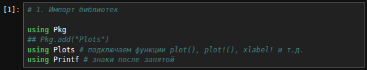{#fig-001 width=70%}

Далее задали начальные параметры модели. Производится ввод ёмкости системы C, полнодоступной части пропускной способности g, интенсивности потоков запросов $\lambda_1$, $\lambda_2$ и интенсивности обслуживания $\mu$. На основе введенных данных рассчитываются предложенные нагрузки $\rho_1$, $\rho_2$. Для численного анализа были выбраны следующие параметры: $C = 90, g = 60, \mu = 0.5, \lambda_1 = 10, \lambda_2 = 15$ ([рис. @fig-002])

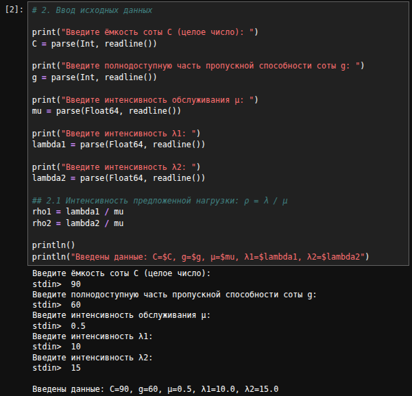{#fig-002 width=70%}

Для расчёта стационарного распределения вероятностей реализовали функцию ```stationary_probability```, которая сначала находит нормирующую константу $p_0$ как сумму слагаемых двух видов: для состояний n ≤ g (принимаются запросы обоих типов) и для n > g (принимаются только запросы 1-го типа). Затем по формуле она вычисляет вероятность p(n) для каждого состояния от 0 до C и возвращает массив из C+1 значений ([рис. @fig-003])

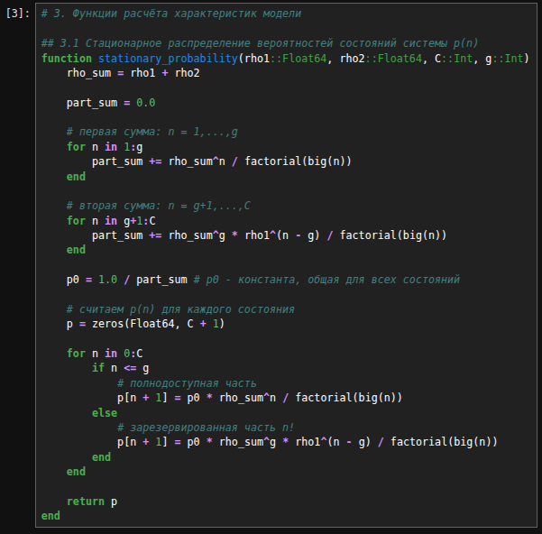{#fig-003 width=70%}

Для расчёта вероятности блокировки по времени $E_1$ реализовали функцию ```time_blocking_probability_E1```. Она возвращает последний элемент массива распределения p(n), соответствующий состоянию n = C, так как запросы 1-го типа блокируются только при полном заполнении системы ([рис. @fig-004])

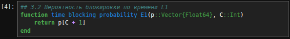{#fig-004 width=70%}

Для расчёта вероятности блокировки по времени $E_2$ реализовали функцию ```time_blocking_probability_E2```. Она возвращает сумму элементов массива распределения p(n) для состояний от n = g до n = C, так как запросы 2-го типа блокируются, как только занята вся полнодоступная часть системы ([рис. @fig-005])

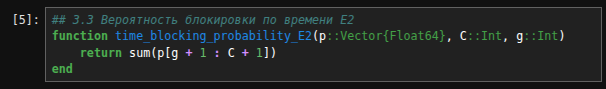{#fig-005 width=70%}

Для расчёта среднего числа обслуживаемых в системе запросов реализовали функцию ```average_requests```. Суммирует произведения n·p(n) по всем состояниям системы от n=0 до n=C. Результат - математическое ожидание числа одновременно занятых каналов при заданной нагрузке ([рис. @fig-006])

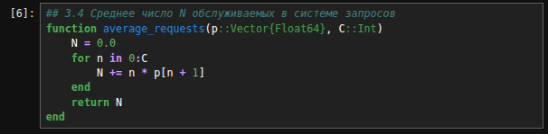{#fig-006 width=70%}

После запустили программу с заданными параметрами и получили стационарное распределение вероятностей состояний системы. На экран вывелись значения $p_n$ для всех n от 0 до C, а также сумма вероятностей, которая равна 1 ([рис. @fig-007]), ([рис. @fig-008])

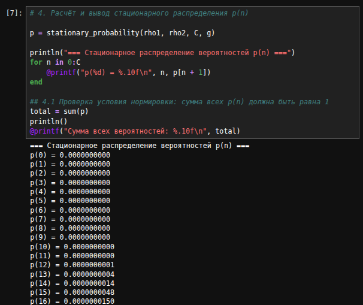{#fig-007 width=70%}

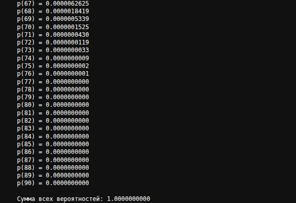{#fig-008 width=70%}

Далее вывели значения вероятностных характеристик модели. 

Вероятность блокировки по времени $E_1$ = 0.0000000000 ([рис. @fig-009])

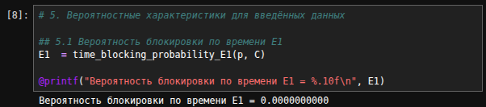{#fig-009 width=70%}

Вероятность блокировки по времени $E_2$ = 0.0317874146 ([рис. @fig-010])

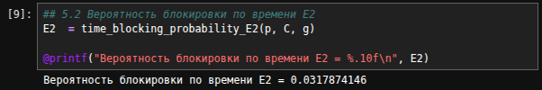{#fig-010 width=70%}

Среднее число обслуживаемых запросов в системе N = 49.0463775608 ([рис. @fig-011])

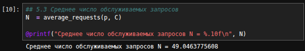{#fig-011 width=70%}

## Построение графиков

Для построения графиков зависимостей вероятностных характеристик от интенсивности поступления запросов $\lambda_1$ был организован цикл по диапазону значений $\lambda_1$ от 0.5 до C с шагом 0.5: для каждого значения $\lambda_1$ заново пересчитывались нагрузка $\rho_1$, распределение вероятностей p(n) и все характеристики модели ($E_1$, $E_2$, N), после чего результаты сохранялись в отдельные массивы. Это позволило получить набор точек для построения графиков зависимости вероятности блокировки по времени $E_1$ и $E_2$ и среднего числа обслуживаемых запросов от интенсивности $\lambda_1$ ([рис. @fig-012])

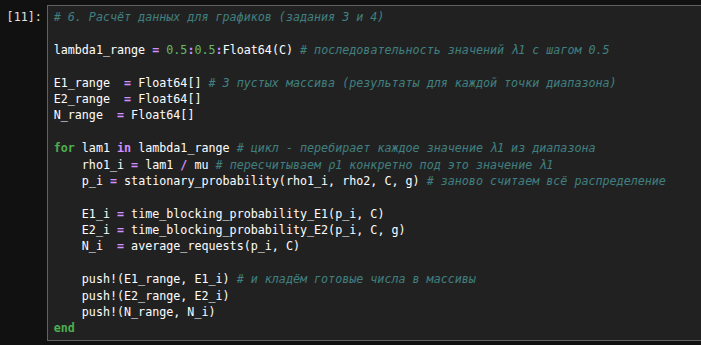{#fig-012 width=70%}

Далее на основе полученных данных построили 4 графика:

- Вероятность блокировки по времени $E_1$($\lambda_1$) ([рис. @fig-013])
- Вероятность блокировки по времени $E_2$($\lambda_1$) ([рис. @fig-014])
- Вероятность блокировки по времени $E_1$($\lambda_1$) и $E_2$($\lambda_1$) для сравнения ([рис. @fig-015])
- Среднее число запросов N(($\lambda_1$) ([рис. @fig-016])

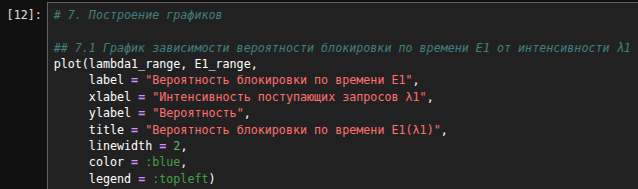{#fig-013 width=70%}

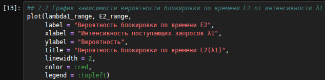{#fig-014 width=70%}

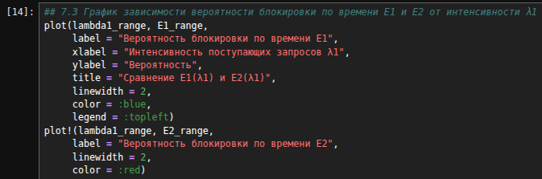{#fig-015 width=70%}

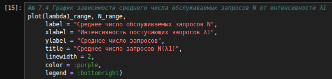{#fig-016 width=70%}

### Анализ графиков

**График $E_1$($\lambda_1$) - вероятность блокировки по времени $E_1$:** на этом графике ([рис. @fig-017]) видно, что при малых значениях $\lambda_1$ ((примерно до 30) вероятность блокировки практически равна нулю, так как запросы 1-го типа блокируются только при полном заполнении системы ($n = C$), а при небольшой нагрузке этого не происходит. Начиная с $\lambda_1 \approx 35$-$40$ кривая резко возрастает, и при $\lambda_1 = 90$ достигает значения около 0.5, поскольку растущая нагрузка всё чаще заполняет систему целиком

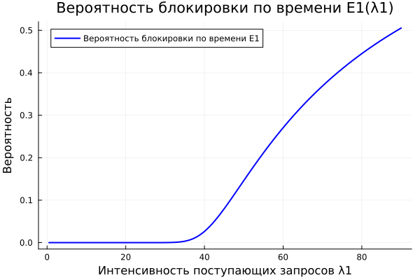{#fig-017 width=70%}

**График $E_2$($\lambda_1$) - вероятность блокировки по времени $E_2$:** на этом графике ([рис. @fig-018]) видно, что вероятность блокировки возрастает значительно быстрее: уже при $\lambda_1 \approx 10$ она начинает расти, а при $\lambda_1 \approx 40$ достигает единицы и дальше остаётся на этом уровне. Это объясняется тем, что запросы 2-го типа блокируются, как только занята вся полнодоступная часть ($n \geq g$), а при большой нагрузке первого типа система почти всегда находится в этих состояниях

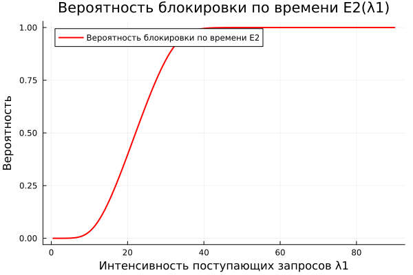{#fig-018 width=70%}

**Сравнение $E_1$($\lambda_1$) и $E_2$($\lambda_1$) - вероятность блокировки по времени $E_1$ и $E_2$:** на этом графике ([рис. @fig-019]) видно, что $E_2$ на всём диапазоне лежит выше $E_1$: она растёт значительно раньше и быстрее и выходит на единицу, тогда как $E_1$ остаётся близкой к нулю до $\lambda_1 \approx 35$ и к $\lambda_1 = 90$ достигает лишь около 0.5. Это наглядно показывает эффект зарезервированной ёмкости: запросам 1-го типа доступна вся ёмкость $C$, а запросам 2-го типа только полнодоступная часть $g$, поэтому они оказываются в менее выгодном положении и блокируются гораздо чаще 

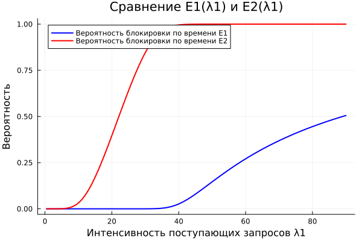{#fig-019 width=70%}

**График N($\lambda_1$) - среднее число обслуживаемых запросов:** на этом графике ([рис. @fig-020]) видно, что $N$ монотонно возрастает с ростом $\lambda_1$ и стремится к $C = 90$: при малых $\lambda_1$ она составляет около 30 (нагрузку создаёт в основном поток 2-го типа, $\rho_2 = 30$), а при больших нагрузках система почти полностью заполнена. На кривой заметен излом в области $\lambda_1 \approx 20$–$40$: после этого участка рост замедляется, поскольку при $\lambda_1 \approx 40$ запросы 2-го типа почти полностью блокируются ($E_2 \to 1$), и дальнейший прирост $N$ обеспечивается только запросами 1-го типа, которые занимают зарезервированную часть ёмкости

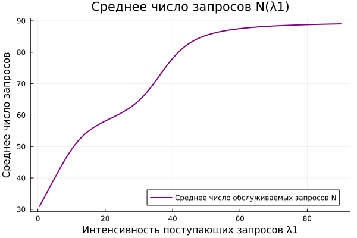{#fig-020 width=70%}

# Листинг программы


```julia
# 1. Импорт библиотек

using Pkg
Pkg.add("Plots")   # устанавливает пакет для построения графиков
using Plots        # подключаем функции plot(), plot!(), xlabel! и т.д.
using Printf # знаки после запятой

# 2. Ввод исходных данных

print("Введите ёмкость соты C (целое число): ")
C = parse(Int, readline())

print("Введите полнодоступную часть пропускной способности соты g: ")
g = parse(Int, readline())

print("Введите интенсивность обслуживания μ: ")
mu = parse(Float64, readline())

print("Введите интенсивность λ1: ")
lambda1 = parse(Float64, readline())

print("Введите интенсивность λ2: ")
lambda2 = parse(Float64, readline())

## 2.1 Интенсивность предложенной нагрузки: ρ = λ / μ
rho1 = lambda1 / mu
rho2 = lambda2 / mu

println()
println("Введены данные: C=$C, g=$g, μ=$mu, λ1=$lambda1, λ2=$lambda2")

# 3. Функции расчёта характеристик модели

## 3.1 Стационарное распределение вероятностей состояний системы p(n)
function stationary_probability(rho1::Float64, rho2::Float64, C::Int, g::Int)
    rho_sum = rho1 + rho2

    part_sum = 0.0

    # первая сумма: n = 1,...,g
    for n in 1:g
        part_sum += rho_sum^n / factorial(big(n))
    end

    # вторая сумма: n = g+1,...,C
    for n in g+1:C
        part_sum += rho_sum^g * rho1^(n - g) / factorial(big(n))
    end

    p0 = 1.0 / part_sum # p0 - константа, общая для всех состояний

    # считаем p(n) для каждого состояния
    p = zeros(Float64, C + 1)

    for n in 0:C
        if n <= g
            # полнодоступная часть
            p[n + 1] = p0 * rho_sum^n / factorial(big(n))
        else
            # зарезервированная часть n!
            p[n + 1] = p0 * rho_sum^g * rho1^(n - g) / factorial(big(n))
        end
    end

    return p
end

## 3.2 Вероятность блокировки по времени E1
function time_blocking_probability_E1(p::Vector{Float64}, C::Int)
    return p[C + 1]
end

## 3.3 Вероятность блокировки по времени E2
function time_blocking_probability_E2(p::Vector{Float64}, C::Int, g::Int)
    return sum(p[g + 1 : C + 1])
end

## 3.4 Среднее число обслуживаемых в системе запросов
function average_requests(p::Vector{Float64}, C::Int)
    N = 0.0
    for n in 0:C
        N += n * p[n + 1]
    end
    return N
end

# 4. Расчёт и вывод стационарного распределения p(n)

p = stationary_probability(rho1, rho2, C, g)

println("=== Стационарное распределение вероятностей p(n) ===")
for n in 0:C
    @printf("p(%d) = %.10f\n", n, p[n + 1])
end

## 4.1 Проверка условия нормировки: сумма всех p(n) должна быть равна 1
total = sum(p)
println()
@printf("Сумма всех вероятностей: %.10f\n", total)

# 5. Вероятностные характеристики для введённых данных

## 5.1 Вероятность блокировки по времени E1
E1  = time_blocking_probability_E1(p, C)
@printf("Вероятность блокировки по времени E1 = %.10f\n", E1)

## 5.2 Вероятность блокировки по времени E2
E2  = time_blocking_probability_E2(p, C, g)
@printf("Вероятность блокировки по времени E2 = %.10f\n", E2)

## 5.3 Среднее число обслуживаемых запросов
N  = average_requests(p, C)
@printf("Среднее число обслуживаемых запросов N = %.10f\n", N)

# 6. Расчёт данных для графиков (задания 3 и 4)

lambda1_range = 0.5:0.5:Float64(C) # последовательность значений λ1 с шагом 0.5

E1_range  = Float64[] # 3 пустых массива (результаты для каждой точки диапазона)
E2_range  = Float64[]
N_range  = Float64[]

for lam1 in lambda1_range # цикл - перебирает каждое значение λ1 из диапазона 
    rho1_i = lam1 / mu # пересчитываем ρ1 конкретно под это значение λ1
    p_i = stationary_probability(rho1_i, rho2, C, g) # заново считаем всё распределение

    E1_i = time_blocking_probability_E1(p_i, C)
    E2_i = time_blocking_probability_E2(p_i, C, g)
    N_i  = average_requests(p_i, C)

    push!(E1_range, E1_i) # и кладём готовые числа в массивы
    push!(E2_range, E2_i)
    push!(N_range, N_i)
end

# 7. Построение графиков

## 7.1 График зависимости вероятности блокировки по времени E1 от интенсивности λ1
plot_E1 = plot(lambda1_range, E1_range,
     label = "Вероятность блокировки по времени E1",
     xlabel = "Интенсивность поступающих запросов λ1",
     ylabel = "Вероятность",
     title = "Вероятность блокировки по времени E1(λ1)",
     linewidth = 2,
     color = :blue,
     legend = :topleft)
savefig(plot_E1, "blocking_probability_E1.png")
display(plot_E1)                                

## 7.2 График зависимости вероятности блокировки по времени E2 от интенсивности λ1
plot_E2 = plot(lambda1_range, E2_range,
     label = "Вероятность блокировки по времени E2",
     xlabel = "Интенсивность поступающих запросов λ1",
     ylabel = "Вероятность",
     title = "Вероятность блокировки по времени E2(λ1)",
     linewidth = 2,
     color = :red,
     legend = :topleft)
savefig(plot_E2, "blocking_probability_E2.png")
display(plot_E2) 

#№ 7.3 График зависимости вероятности блокировки по времени E1 и E2 от интенсивности λ1
plot_E1_E2 = plot(lambda1_range, E1_range,
     label = "Вероятность блокировки по времени E1",
     xlabel = "Интенсивность поступающих запросов λ1",
     ylabel = "Вероятность",
     title = "Сравнение E1(λ1) и E2(λ1)",
     linewidth = 2,
     color = :blue,
     legend = :topleft)
plot!(lambda1_range, E2_range,
     label = "Вероятность блокировки по времени E2",
     linewidth = 2,
     color = :red)
savefig(plot_E1_E2, "blocking_probability_E1_E2.png")
display(plot_E1_E2)

#№ 7.4 График зависимости среднего числа обслуживаемых запросов N от интенсивности λ1
plot_N = plot(lambda1_range, N_range,
     label = "Среднее число обслуживаемых запросов N",
     xlabel = "Интенсивность поступающих запросов λ1",
     ylabel = "Среднее число запросов",
     title = "Среднее число запросов N(λ1)",
     linewidth = 2,
     color = :purple,
     legend = :bottomright)
savefig(plot_N, "average_requests_N.png")
display(plot_N)
```

# Выводы

В ходе выполнения лабораторной работы №2 была изучена неполнодоступная двухсервисная модель Эрланга с одинаковыми интенсивностями обслуживания и зарезервированной емкостью, а также реализованы для заданных параметров алгоритмы расчёта распределения вероятностей, вероятности блокировки по времени для запросов каждого типа, среднего числа обслуживаемых и построены графики зависимости вероятности блокировки от интенсивности предложенной нагрузки, создаваемой запросами первого типа  и зависимости среднего числа обслуживаемых запросов от интенсивности поступления запросов на предоставление услуги. 

Анализ графиков показал, что:

- Вероятность блокировки по времени $E_1$($\lambda_1$) возрастает, сначала остаётся почти нулевой, а при большой нагрузке заметно растёт

- Вероятность блокировки по времени $E_2$($\lambda_1$) возрастает значительно быстрее $E_1$ и выходит на единицу, что обусловлено зарезервированной ёмкостью

- Среднее число запросов N($\lambda_1$) монотонно возрастает и стремится к ёмкости системы $C$, при этом рост замедляется после того, как запросы 2-го типа почти полностью блокируются

Моделирование было успешно выполнено на языке Julia.
