---
## Author
author:
  name: Верниковская Екатерина Андреевна
  degrees: DSc
  orcid: 0000-0002-0877-7063
  email: kulyabov-ds@rudn.ru
  affiliation:
    - name: Российский университет дружбы народов
      country: Российская Федерация
      postal-code: 117198
      city: Москва
      address: ул. Миклухо-Маклая, д. 6

## Title
title: "Отчёт по лабораторной работе №3"
subtitle: "Дисциплина: Основы проектирования сетей и систем телекоммуникаций"
license: "CC BY"
---

# Цель работы

Целью данной работы является изучение двухсервисной модели с эластичным трафиком, а также реализация для заданных параметров расчёта распределения вероятностей, среднего числа обслуживаемых запросов, среднего времени обслуживания запроса и построение графиков зависимости среднего числа обслуживаемых запросов от интенсивности поступления запросов на предоставление услуги и зависимости среднего времени обслуживания запроса от интенсивности поступления запросов на обслуживание

# Задание

1. Описать пошагово алгоритм расчета вероятностных характеристик модели (вероятности блокировки запроса каждого типа, среднего числа запросов в системе)

2. Составить программу, реализующую расчет распределения вероятностей, среднего числа обслуживаемых запросов для любых значений исходных данных, среднего времени обслуживания запроса. Программа должна выводить на экран:

	- значение распределения вероятностей,
	- значение среднего числа запросов,
	- значение среднего времени обслуживания запроса.

3. Построить график зависимости среднего времени обслуживания запроса от интенсивности поступления запросов на обслуживание

4. Построить график зависимости среднего числа обслуживаемых запросов от интенсивности поступления запросов на предоставление услуги

# Выполнение лабораторной работы

## Теория

Проаназируем соту сети емкостью $С$. Пусть пользователи генерируют запросы на передачу данных двух типов. Запросы на передачу данных представляют собой ПП с интенсивностью $\lambda_i, i = 1,2$. Средняя длина передаваемого файла $\theta_i, i = 1,2$. Минимальная емкость, необходимая для
передачи данных равна $b_i, i = 1,2$.

Основные обозначения указаны в (табл. \ref{table:tbale})

\begin{table}[H]
\centering
\caption{Основные обозначения}
\label{table:tbale}
\begin{tabular}{|p{4cm}|p{13cm}|}
\hline
\textbf{Переменная} & \textbf{Обозначение} \\ \hline
C & пиковая пропускная способность соты \\ \hline
$\lambda_i, i = 1,2$ & интенсивность поступления запросов на передачу данных первого/второго типа [запросов/ед.вр] \\ \hline
$\theta_i, i = 1,2$ & длина передаваемого файла первого/второго типа [бит] \\ \hline
$\rho_i^1, i = 1,2$ & интенсивность предложенной нагрузки, создаваемой запросами на передачу данных первого/второго типа \\ \hline
$a_i, i = 1,2$ & доля нагрузки, создаваемой запросами на передачу данных первого/второго типа, которая приходится на единицу пропускной способности (безразмерная величина) \\ \hline
$b_i, i = 1,2$ & минимальное требование к ресурсам сети, необходимое для передачи данных первого/второго типа \\ \hline
$X_i(t), i = 1,2$ & число обслуживаемых в системе запросов на передачу данных первого/второго типа в момент времени $t, t \ge 0$ \\ \hline
$X(t) = (X_1(t), X_2(t))$ & СП, описывающий функционирование системы в момент времени $t, t \ge 0$ \\ \hline
$X$ & пространство состояний системы \\ \hline
$n_i, i = 1,2$ & число передаваемых в системе блоков данных первого/второго типа \\ \hline
$B_i, i = 1,2$ & множество блокировок запросов на передачу данных первого/второго типа \\ \hline
$S_i, i = 1,2$ & множество приема запросов на передачу данных первого/второго типа \\ \hline
\end{tabular}
\end{table}

Пространство состояний системы: $$X = \{(n_1, n_2) : n_1 \ge 0, n_2 \ge 0\}$$

Множество блокировок запросов на передачу данных: $$B_i = \{\varnothing\}, i = 1,2$$

Множество приема запросов на передачу данных: $$S_i = \overline{B}_i = X \setminus B_i = \{0, 1, 2, \dots\}, i = 1,2$$

Система уравнений частичного баланса (СУЧБ) имеет вид: 

$$
\begin{cases}
  p(n_1, n_2) \dfrac{C}{(n_1 + n_2)\theta_1} n_1 = \lambda_1 p(n_1 - 1, n_2), & n_1 > 0, \\
  \\
  p(n_1, n_2) \dfrac{C}{(n_1 + n_2)\theta_2} n_2 = \lambda_2 p(n_1, n_2 - 1), & n_2 > 0,
\end{cases} \quad (n_1, n_2) \in X
$$

Обозначим $\rho_i = \lambda_i \theta_i$, $a_i = \frac{\rho_i}{C}$, $\rho_i < C$, $i = 1,2$

Стационарное распределение вероятностей состояний системы: $$p(n_1, n_2) = \frac{a_1^{n_1}}{n_1!} \frac{a_2^{n_2}}{n_2!} (n_1 + n_2)! p(0,0),$$

где $p(0,0) = \left( \sum_{(n_1, n_2) \in \mathbf{X}} (n_1 + n_2)! \dfrac{a_1^{n_1}}{n_1!} \dfrac{a_2^{n_2}}{n_2!} \right)^{-1}$

Основные вероятностные характеристики модели:

- Вероятность блокировки по времени $E_i, i = 1,2$ запроса на передачу данных первого/второго
типа: $$E_1 = E_2 = 0$$

- Среднее число $\bar{N_i}, i = 1,2$ обслуживаемых в системе запросов на передачу данных
первого/второго типа: $$\overline{N}_i = \lambda_i \dfrac{\theta_i}{(\theta_1 \lambda_1 + \theta_2 \lambda_2)}, \quad i = 1,2$$

- Среднее время $T_i, i = 1,2$ обслуживания запроса на передачу данных первого/второго типа: $$T_i = \dfrac{\overline{N}_i}{\lambda_i}$$

## Реализация алгоритма на Julia

Код был написан на языке Julia и выполнен в среде разраоти Jupyter.

Для визуализации использовали библиотеку Plots, которая подключается командами ```using Pkg``` и ```using Plots``` (при необходимости пакет предварительно устанавливается через ```Pkg.add("Plots")```). Также использовали библиотеку Printf, которая позволяет выводить заданное колличсевто знаков после запятой ([рис. @fig-001])

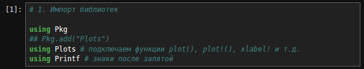{#fig-001 width=70%}

Далее задали начальные параметры модели. Производится ввод ёмкости системы C, интенсивности потоков запросов $\lambda_1$, $\lambda_2$, длины файлов $\theta_1$, $\theta_2$ и максимального числа запросов $n_1$_max и $n_2$_max (границы суммирования). На основе введенных данных рассчитываются предложенные нагрузки $\rho_1$, $\rho_2$ и доли нагрузки $a_1$, $a_2$. Для численного анализа были выбраны следующие параметры: $C = 20, \lambda_1 = 3, \lambda_2 = 13, \theta_1 = 2, \theta_2 = 3$, $n_1$_max = 4, $n_2$_max = 5 ([рис. @fig-002])

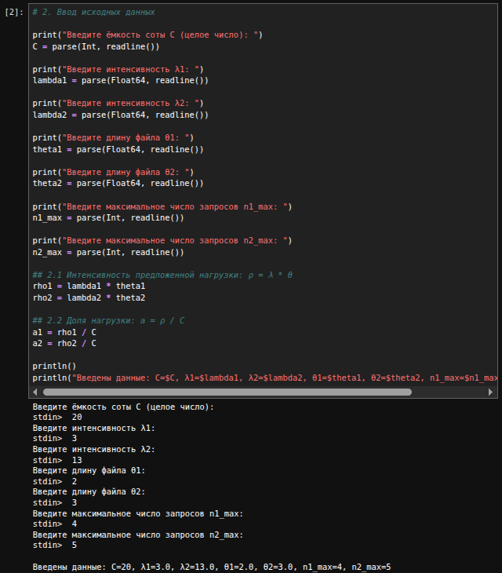{#fig-002 width=70%}

Для расчёта стационарного распределения вероятностей реализовали функцию ```stationary_probability```, которая сначала находит нормировочный множитель p(0,0) суммированием по всем состояниям сетки, а затем возвращает вероятность $p(n_1, n_2)$ заданного состояния по формуле ([рис. @fig-003])

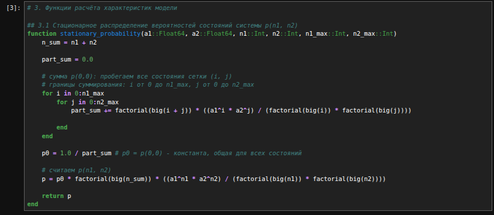{#fig-003 width=70%}

Для расчёта вероятности блокировки по времени $E_i, i = 1,2$ реализовали функцию ```time_blocking_probability```. Она возвращает 0 для всех двух типов услуг, так как её нет в модели с эластичным трафиком ([рис. @fig-004])

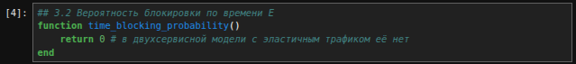{#fig-004 width=70%}

Для расчёта среднего числа $\overline{N}_i, i = 1,2$ обслуживаемых в системе запросов реализовали функцию ```average_requests```.  Она возвращает отношение нагрузки $\lambda_i\theta_i$, создаваемой запросами $i$-го типа, к суммарной нагрузке $\theta_1\lambda_1 + \theta_2\lambda_2$ ([рис. @fig-005])

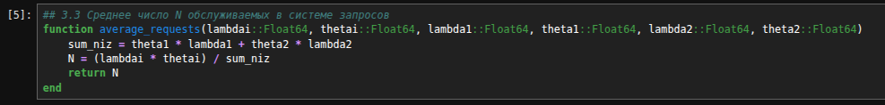{#fig-005 width=70%}

Для расчёта среднего времени $T_i, i = 1,2$ обслуживания запроса реализовали функцию ```average_time```. Она делит среднее число запросов $\overline{N}_i$ $i$-го типа на интенсивность их поступления $\lambda_i$ и возвращает результат ([рис. @fig-006])

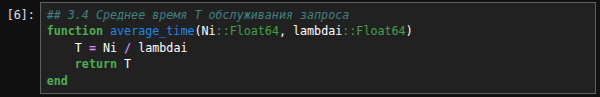{#fig-006 width=70%}

После запустили программу с заданными параметрами и получили стационарное распределение вероятностей состояний системы. На экран вывелись значения $p(n_1, n_2)$ для всех $n_1$ от 0 до 4 и $n_2$ от 0 до 5, а также сумма вероятностей, которая равна 1 ([рис. @fig-007]), ([рис. @fig-008])

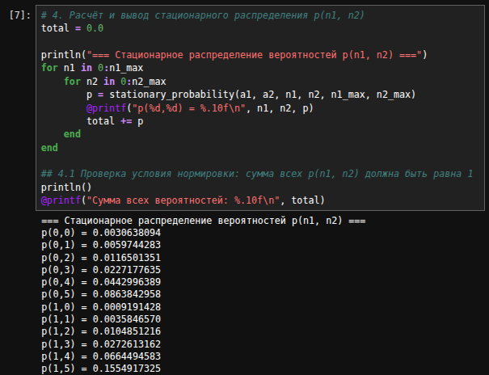{#fig-007 width=70%}

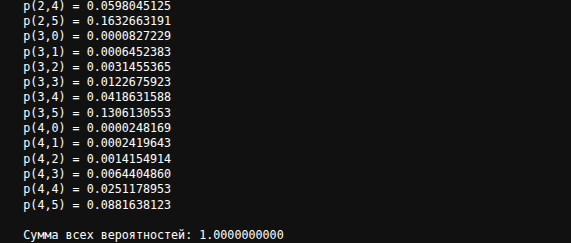{#fig-008 width=70%}

Далее вывели значения вероятностных характеристик модели. 

Вероятность блокировки по времени $E_1$ = 0.0000000000 ([рис. @fig-009])

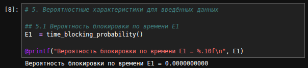{#fig-009 width=70%}

Вероятность блокировки по времени $E_2$ = 0.0000000000 ([рис. @fig-010])

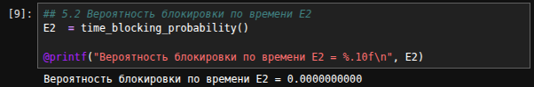{#fig-010 width=70%}

Среднее число обслуживаемых запросов $N_1$ = 0.1333333333 ([рис. @fig-011])

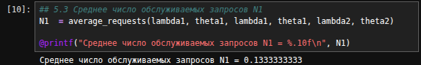{#fig-011 width=70%}

Среднее число обслуживаемых запросов $N_2$ = 0.8666666667 ([рис. @fig-012])

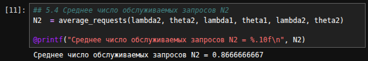{#fig-012 width=70%}

Среднее время обслуживания запроса $T_1$ = 0.0444444444 ([рис. @fig-013])

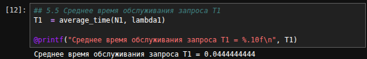{#fig-013 width=70%}

Среднее время обслуживания запроса $T_2$ = 0.0666666667 ([рис. @fig-014])

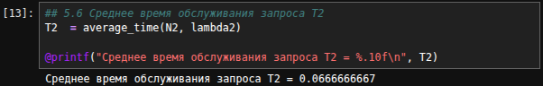{#fig-014 width=70%}

## Построение графиков

Для построения графиков зависимостей вероятностных характеристик от интенсивности поступления запросов $\lambda_1$ был организован цикл по диапазону значений $\lambda_1$ от 0.5 до C с шагом 0.5: для каждого значения $\lambda_1$ заново пересчитывались характеристики модели ($N_1$, $N_2$, $T_1$ и $T_2$), после чего результаты сохранялись в отдельные массивы. Это позволило получить набор точек для построения графиков зависимости среднего числа $N_1$, $N_2$ обслуживаемых запросов от интенсивности $\lambda_1$ и зависимости среднего времени $T_1$, $T_2$ обслуживания запроса от интенсивности $\lambda_1$ ([рис. @fig-012])

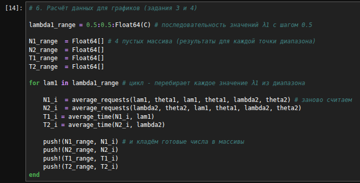{#fig-012 width=70%}

Далее на основе полученных данных построили 6 графиков:

- Среднее число обслуживаемых запросов $N_1$($\lambda_1$) ([рис. @fig-016])
- Среднее число обслуживаемых запросов $N_2$($\lambda_1$) ([рис. @fig-017])
- Среднее число обслуживаемых запросов $N_1$($\lambda_1$) и $N_2$($\lambda_1$) для сравнения ([рис. @fig-018])
- Среднее время обслуживания запроса $T_1$($\lambda_1$) ([рис. @fig-019])
- Среднее время обслуживания запроса $T_2$($\lambda_1$) ([рис. @fig-020])
- Среднее время обслуживания запроса $T_1$($\lambda_1$) и $T_2$($\lambda_1$) для сравнения ([рис. @fig-021])

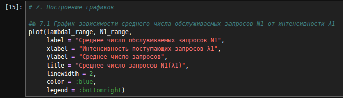{#fig-016 width=70%}

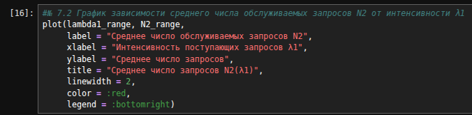{#fig-017 width=70%}

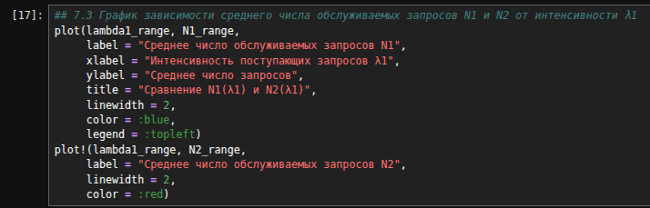{#fig-018 width=70%}

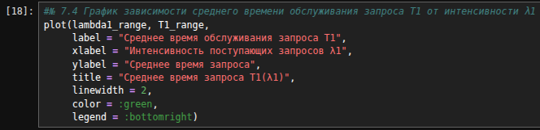{#fig-019 width=70%}

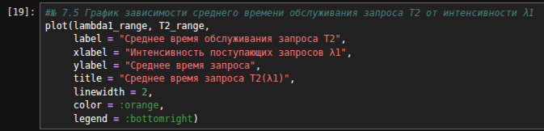{#fig-020 width=70%}

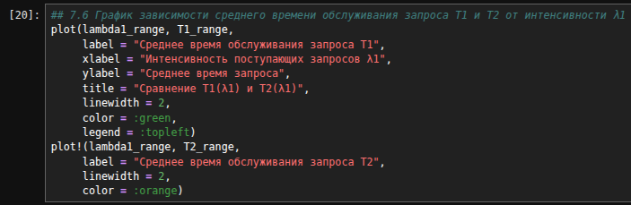{#fig-021 width=70%}

### Анализ графиков

**График $N_1$($\lambda_1$) - среднее число обслуживаемых запросов $N_1$:** на этом графике ([рис. @fig-022]) видно, что $N_1$ монотонно возрастает с ростом $\lambda_1$ (от значения около 0.02 до примерно 0.5 при $\lambda_1 = 20$), при этом рост постепенно замедляется. Это объясняется тем, что $N_1$ равно доле нагрузки первого типа $\lambda_1\theta_1$ в суммарной нагрузке $\theta_1\lambda_1 + \theta_2\lambda_2$: с ростом $\lambda_1$ эта доля увеличивается, но стремится к единице, не достигая её, так как нагрузка второго типа остаётся неизменной

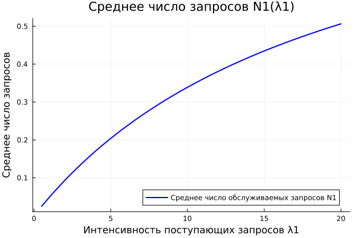{#fig-022 width=70%}

**График $N_2$($\lambda_1$) - среднее число обслуживаемых запросов $N_2$:** на этом графике ([рис. @fig-023]) видно, что $N_2$ монотонно убывает с ростом $\lambda_1$ (от значения около 0.98 до примерно 0.5 при $\lambda_1 = 20$), при этом темп убывания постепенно замедляется. Это объясняется тем, что $N_2$ равно доле нагрузки второго типа $\lambda_2\theta_2$ в суммарной нагрузке $\theta_1\lambda_1 + \theta_2\lambda_2$: с ростом $\lambda_1$ знаменатель увеличивается, а числитель остаётся неизменным, поэтому доля $N_2$​ уменьшается, стремясь к нулю при $\lambda_1 \to \infty$, но при $\lambda_1 = 20$ ещё не достигает нуля

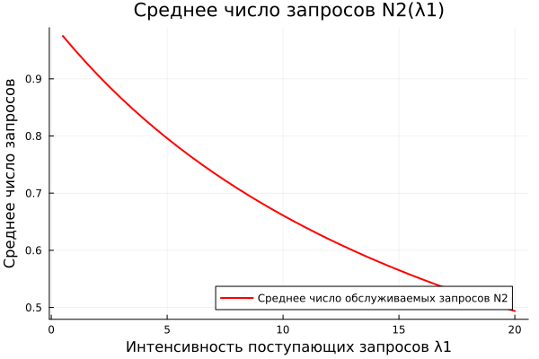{#fig-023 width=70%}

**Сравнение $N_1$($\lambda_1$) и $N_2$($\lambda_1$) - среднее число обслуживаемых запросов $N_1$ и $N_2$:** на этом графике ([рис. @fig-024]) видно, что $N_1$ монотонно возрастает, а $N_2$ монотонно убывает с ростом $\lambda_1$, причём обе кривые сближаются и пересекаются в точке $\lambda_1 \approx 20$, где $N_1 = N_2 \approx 0.5$. Это объясняется тем, что $N_1$ и $N_2$ представляют собой доли нагрузки первого и второго типов в суммарной нагрузке $\theta_1 \lambda_1 + \theta_2 \lambda_2$: при увеличении $\lambda_1$ доля первого типа растёт, а второго - падает, и в точке пересечения нагрузки обоих типов становятся равными, то есть $\theta_1 \lambda_1 = \theta_2 \lambda_2$. При дальнейшем росте $\lambda_1$ кривая $N_1$ продолжит возрастать, стремясь к единице, а $N_2$ - убывать, стремясь к нулю

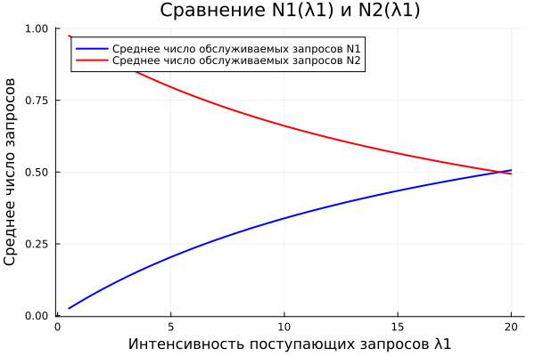{#fig-024 width=70%}

**График $T_1$($\lambda_1$) - среднее время обслуживания запроса $T_1$:** на этом графике ([рис. @fig-025]) видно, что $T_1$ монотонно убывает с ростом $\lambda_1$ (от значения около $0.05$ до примерно $0.025$ при $\lambda_1 = 20$), при этом темп убывания постепенно замедляется. Это объясняется тем, что среднее время обслуживания запроса первого типа определяется как $T_1 = \dfrac{N_1}{\lambda_1} = \dfrac{\theta_1}{\theta_1 \lambda_1 + \theta_2 \lambda_2}$: с ростом $\lambda_1$ знаменатель суммарной нагрузки увеличивается, а числитель $\theta_1$ остаётся неизменным, поэтому $T_1$ уменьшается, стремясь к нулю при $\lambda_1 \to \infty$. Физически это означает, что при высокой интенсивности поступления запросов первого типа каждый из них получает всё меньшую долю общей пропускной способности соты, поскольку ресурс делится между всеми активными запросами

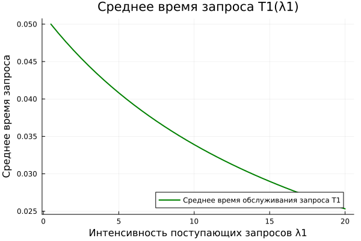{#fig-025 width=70%}

**График $T_2$($\lambda_1$) - среднее время обслуживания запроса $T_2$:** на этом графике ([рис. @fig-026]) видно, что $T_2$ монотонно убывает с ростом $\lambda_1$ (от значения около $0.075$ до примерно $0.037$ при $\lambda_1 = 20$), при этом темп убывания постепенно замедляется. Это объясняется тем, что среднее время обслуживания запроса второго типа определяется как $T_2 = \dfrac{N_2}{\lambda_2} = \dfrac{\theta_2}{\theta_1 \lambda_1 + \theta_2 \lambda_2}$: с ростом $\lambda_1$ суммарная нагрузка в знаменателе увеличивается, а числитель $\theta_2$ и интенсивность $\lambda_2$ остаются неизменными, поэтому $T_2$ уменьшается, стремясь к нулю при $\lambda_1 \to \infty$. Физически это означает, что при высокой интенсивности поступления запросов первого типа общая пропускная способность соты перераспределяется, и каждый запрос второго типа обслуживается быстрее, поскольку эластичный трафик делит ресурс пропорционально числу активных запросов

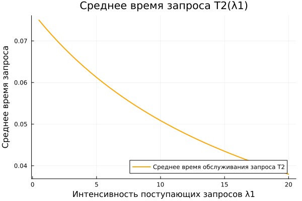{#fig-026 width=70%}

**Сравнение $T_1$($\lambda_1$) и $T_2$($\lambda_1$) - среднее время обслуживания запроса $T_1$ и $T_2$:** на этом графике ([рис. @fig-027]) видно, что обе кривые монотонно убывают с ростом $\lambda_1$, причём $T_2$ на всём рассматриваемом диапазоне остаётся выше $T_1$ (например, при $\lambda_1 = 20$ значения составляют примерно $T_1 \approx 0.025$ и $T_2 \approx 0.037$), и кривые не пересекаются. Это объясняется тем, что средние времена обслуживания определяются как $T_1 = \dfrac{\theta_1}{\theta_1 \lambda_1 + \theta_2 \lambda_2}$ и $T_2 = \dfrac{\theta_2}{\theta_1 \lambda_1 + \theta_2 \lambda_2}$ - знаменатель у них общий, а отношение $\dfrac{T_2}{T_1} = \dfrac{\theta_2}{\theta_1}$ постоянно. Поэтому график $T_2$ - это просто график $T_1$, растянутый по вертикали в $\dfrac{\theta_2}{\theta_1}$ раз: кривые пропорциональны и не пересекаются, а их взаимное расположение задаётся соотношением длин файлов $\theta_1$ и $\theta_2$. С ростом $\lambda_1$ суммарная нагрузка увеличивается, и оба времени уменьшаются, стремясь к нулю при $\lambda_1 \to \infty$, поскольку каждый запрос получает всё меньшую долю общей пропускной способности соты

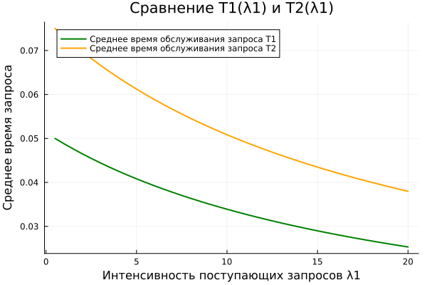{#fig-027 width=70%}

# Листинг программы


```julia
# 1. Импорт библиотек

using Pkg
Pkg.add("Plots")   # устанавливает пакет для построения графиков
using Plots        # подключаем функции plot(), plot!(), xlabel! и т.д.
using Printf # знаки после запятой

# 2. Ввод исходных данных

print("Введите ёмкость соты C (целое число): ")
C = parse(Int, readline())

print("Введите интенсивность λ1: ")
lambda1 = parse(Float64, readline())

print("Введите интенсивность λ2: ")
lambda2 = parse(Float64, readline())

print("Введите длину файла θ1: ")
theta1 = parse(Float64, readline())

print("Введите длину файла θ2: ")
theta2 = parse(Float64, readline())

print("Введите максимальное число запросов n1_max: ")
n1_max = parse(Int, readline())

print("Введите максимальное число запросов n2_max: ")
n2_max = parse(Int, readline())

## 2.1 Интенсивность предложенной нагрузки: ρ = λ * θ
rho1 = lambda1 * theta1
rho2 = lambda2 * theta2

## 2.2 Доля нагрузки: a = ρ / C
a1 = rho1 / C
a2 = rho2 / C

println()
println("Введены данные: C=$C, λ1=$lambda1, λ2=$lambda2, θ1=$theta1, θ2=$theta2, n1_max=$n1_max, n2_max=$n2_max")

# 3. Функции расчёта характеристик модели

## 3.1 Стационарное распределение вероятностей состояний системы p(n1, n2)
function stationary_probability(a1::Float64, a2::Float64, n1::Int, n2::Int, n1_max::Int, n2_max::Int)
    n_sum = n1 + n2

    part_sum = 0.0

    # сумма p(0,0): пробегаем все состояния сетки (i, j)
    # границы суммирования: i от 0 до n1_max, j от 0 до n2_max
    for i in 0:n1_max 
        for j in 0:n2_max
            part_sum += factorial(big(i + j)) * ((a1^i * a2^j) / (factorial(big(i)) * factorial(big(j))))
    
        end
    end

    p0 = 1.0 / part_sum # p0 = p(0,0) - константа, общая для всех состояний

    # считаем p(n1, n2)
    p = p0 * factorial(big(n_sum)) * ((a1^n1 * a2^n2) / (factorial(big(n1)) * factorial(big(n2))))
    
    return p
end

## 3.2 Вероятность блокировки по времени E
function time_blocking_probability()
    return 0 # в двухсервисной модели с эластичным трафиком её нет
end

## 3.3 Среднее число N обслуживаемых в системе запросов
function average_requests(lambdai::Float64, thetai::Float64, lambda1::Float64, theta1::Float64, lambda2::Float64, theta2::Float64)
    sum_niz = theta1 * lambda1 + theta2 * lambda2
    N = (lambdai * thetai) / sum_niz
    return N
end

## 3.4 Среднее время T обслуживания запроса
function average_time(Ni::Float64, lambdai::Float64)
    T = Ni / lambdai
    return T
end

# 4. Расчёт и вывод стационарного распределения p(n)

total = 0.0

println("=== Стационарное распределение вероятностей p(n1, n2) ===")
for n1 in 0:n1_max
    for n2 in 0:n2_max
        p = stationary_probability(a1, a2, n1, n2, n1_max, n2_max)
        @printf("p(%d,%d) = %.10f\n", n1, n2, p)
        global total += p
    end
end

## 4.1 Проверка условия нормировки: сумма всех p(n1, n2) должна быть равна 1
println()
@printf("Сумма всех вероятностей: %.10f\n", total)

# 5. Вероятностные характеристики для введённых данных

## 5.1 Вероятность блокировки по времени E1
E1  = time_blocking_probability()
@printf("Вероятность блокировки по времени E1 = %.10f\n", E1)

## 5.2 Вероятность блокировки по времени E2
E2  = time_blocking_probability()
@printf("Вероятность блокировки по времени E2 = %.10f\n", E2)

## 5.3 Среднее число обслуживаемых запросов N1
N1  = average_requests(lambda1, theta1, lambda1, theta1, lambda2, theta2)
@printf("Среднее число обслуживаемых запросов N1 = %.10f\n", N1)

## 5.4 Среднее число обслуживаемых запросов N2
N2  = average_requests(lambda2, theta2, lambda1, theta1, lambda2, theta2)
@printf("Среднее число обслуживаемых запросов N2 = %.10f\n", N2)

## 5.5 Среднее время обслуживания запроса T1
T1  = average_time(N1, lambda1)
@printf("Среднее время обслуживания запроса T1 = %.10f\n", T1)

## 5.6 Среднее время обслуживания запроса T2
T2  = average_time(N2, lambda2)
@printf("Среднее время обслуживания запроса T2 = %.10f\n", T2)

# 6. Расчёт данных для графиков (задания 3 и 4)

lambda1_range = 0.5:0.5:Float64(C) # последовательность значений λ1 с шагом 0.5

N1_range  = Float64[] # 4 пустых массива (результаты для каждой точки диапазона)
N2_range  = Float64[]
T1_range  = Float64[]
T2_range  = Float64[]

for lam1 in lambda1_range # цикл - перебирает каждое значение λ1 из диапазона 
    
    N1_i  = average_requests(lam1, theta1, lam1, theta1, lambda2, theta2) # заново считаем
    N2_i  = average_requests(lambda2, theta2, lam1, theta1, lambda2, theta2)
    T1_i = average_time(N1_i, lam1)
    T2_i = average_time(N2_i, lambda2)
    
    push!(N1_range, N1_i) # и кладём готовые числа в массивы
    push!(N2_range, N2_i)
    push!(T1_range, T1_i)
    push!(T2_range, T2_i)
end

# 7. Построение графиков

#№ 7.1 График зависимости среднего числа обслуживаемых запросов N1 от интенсивности λ1
plot_N1 = plot(lambda1_range, N1_range,
     label = "Среднее число обслуживаемых запросов N1",
     xlabel = "Интенсивность поступающих запросов λ1",
     ylabel = "Среднее число запросов",
     title = "Среднее число запросов N1(λ1)",
     linewidth = 2,
     color = :blue,
     legend = :bottomright)
savefig(plot_N1, "average_requests_N1.png")
display(plot_N1)                                

## 7.2 График зависимости среднего числа обслуживаемых запросов N2 от интенсивности λ1
plot_N2 = plot(lambda1_range, N2_range,
     label = "Среднее число обслуживаемых запросов N2",
     xlabel = "Интенсивность поступающих запросов λ1",
     ylabel = "Среднее число запросов",
     title = "Среднее число запросов N2(λ1)",
     linewidth = 2,
     color = :red,
     legend = :bottomright)
savefig(plot_N2, "average_requests_N2.png")
display(plot_N2) 

#№ 7.3 График зависимости среднего числа обслуживаемых запросов N1 и N2 от интенсивности λ1
plot_N1_N2 = plot(lambda1_range, N1_range,
     label = "Среднее число обслуживаемых запросов N1",
     xlabel = "Интенсивность поступающих запросов λ1",
     ylabel = "Среднее число запросов",
     title = "Сравнение N1(λ1) и N2(λ1)",
     linewidth = 2,
     color = :blue,
     legend = :topleft)
plot!(lambda1_range, N2_range,
     label = "Среднее число обслуживаемых запросов N2",
     linewidth = 2,
     color = :red)
savefig(plot_N1_N2, "average_requests_N1_N2.png")
display(plot_N1_N2)

#№ 7.4 График зависимости среднего времени обслуживания запроса T1 от интенсивности λ1
plot_T1 = plot(lambda1_range, T1_range,
     label = "Среднее время обслуживания запроса T1",
     xlabel = "Интенсивность поступающих запросов λ1",
     ylabel = "Среднее время запроса",
     title = "Среднее время запроса T1(λ1)",
     linewidth = 2,
     color = :green,
     legend = :bottomright)
savefig(plot_T1, "average_time_T1.png")
display(plot_T1)

#№ 7.5 График зависимости среднего времени обслуживания запроса T2 от интенсивности λ1
plot_T2 = plot(lambda1_range, T2_range,
     label = "Среднее время обслуживания запроса T2",
     xlabel = "Интенсивность поступающих запросов λ1",
     ylabel = "Среднее время запроса",
     title = "Среднее время запроса T2(λ1)",
     linewidth = 2,
     color = :orange,
     legend = :bottomright)
savefig(plot_T2, "average_time_T2.png")
display(plot_T2)

## 7.6 График зависимости среднего времени обслуживания запроса T1 и T2 от интенсивности λ1
plot_T1_T2 = plot(lambda1_range, T1_range,
     label = "Среднее время обслуживания запроса T1",
     xlabel = "Интенсивность поступающих запросов λ1",
     ylabel = "Среднее время запроса",
     title = "Сравнение T1(λ1) и T2(λ1)",
     linewidth = 2,
     color = :green,
     legend = :topleft)
plot!(lambda1_range, T2_range,
     label = "Среднее время обслуживания запроса T2",
     linewidth = 2,
     color = :orange)
savefig(plot_T1_T2, "average_time_T1_T2.png")
display(plot_T1_T2)
```

# Выводы

В ходе выполнения лабораторной работы №3 была изучена двухсервисная модель с эластичным трафиком, а также реализованы для заданных параметров алгоритмы расчёта распределения вероятностей, среднего числа обслуживаемых запросов, среднего времени обслуживания запроса и построены графики зависимости среднего числа обслуживаемых запросов от интенсивности поступления запросов на предоставление услуги и зависимости среднего времени обслуживания запроса от интенсивности поступления запросов на обслуживание

Анализ графиков показал, что:

- Среднее число запросов $N_1$($\lambda_1$) монотонно возрастает и стремится к единице, при этом рост замедляется, так как доля нагрузки первого типа в суммарной нагрузке увеличивается, но не может превысить единицу

- Среднее число запросов $N_2$($\lambda_1$) монотонно убывает и стремится к нулю, что обусловлено неизменной нагрузкой второго типа на фоне растущей суммарной нагрузки $\theta_1 \lambda_1 + \theta_2 \lambda_2$

- Графики $N_1$($\lambda_1$) и $N_2$($\lambda_1$) пересекаются в точке $\lambda_1 \approx 20$, где где нагрузки обоих типов становятся равными $\theta_1 \lambda_1 = \theta_2 \lambda_2$

- Средние времена обслуживания $T_1$($\lambda_1$) и $T_2$($\lambda_1$) монотонно убывают с ростом $\lambda_1$ причём $T_2$ остаётся выше $T_1$ на всём диапазоне, а их отношение $\dfrac{T_2}{T_1} = \dfrac{\theta_2}{\theta_1}$ постоянно, поэтому кривые пропорциональны и не пересекаются

Моделирование было успешно выполнено на языке Julia.
