---
## Author
author:
  name: Верниковская Екатерина Андреевна
  degrees: DSc
  orcid: 0000-0002-0877-7063
  email: kulyabov-ds@rudn.ru
  affiliation:
    - name: Российский университет дружбы народов
      country: Российская Федерация
      postal-code: 117198
      city: Москва
      address: ул. Миклухо-Маклая, д. 6

## Title
title: "Отчёт по лабораторной работе №4"
subtitle: "Дисциплина: Основы проектирования сетей и систем телекоммуникаций"
license: "CC BY"
---

# Цель работы

Целью данной работы является изучение неполнодоступной двухсервисной модели Эрланга с резервированием для заявок второго типа и разными интенсивностями обслуживания

# Задание

1. Описать модель

2. Нарисовать схему модели

3. Определить пространство состояний

4. Построить диаграмму интенсивностей переходов

5. Определить множества блокировок и приема

6. Выписать СУГБ, СУЛБ

7. Получить формулу для расчета распределения вероятностей

8. Получить формулу для расчета вероятности блокировки заявки каждого типа

9. Получить формулу для расчета среднего числа обслуживаемых в системе заявок

10. Составить программу, реализующую расчет распределения вероятностей, вероятности блокировки, среднего числа заявок для любых значений исходных данных

11. Построить график зависимости вероятности блокировки от интенсивности поступления заявок

12. Построить график зависимости среднего числа обслуживаемых заявок от интенсивности поступления заявок на предоставление услуги

# Выполнение лабораторной работы

## Теория

Рассматривается звено сети ёмкостью $C$. Пользователям сети предоставляются услуги двух типов. Запросы на предоставление услуг представляют собой ПП с интенсивностями $\lambda_1, \lambda_2$. Среднее время обслуживания запросов каждого типа $\mu_1^{-1}, \mu_2^{-1}$ соответственно.  Каждый запрос занимает ровно один прибор (b1 = b2 = 1). В классификации Башарина-Кендалла $\mathop{MM}\limits_{\lambda_1\lambda_2} \mid \mathop{MM}\limits_{\mu_1\mu_2} \mid C \mid 0$

Основные обозначения указаны в (табл. \ref{table:tbale})

\begin{table}[H]
\centering
\caption{Основные обозначения}
\label{table:tbale}
\begin{tabular}{|p{4cm}|p{13cm}|}
\hline
\textbf{Переменная} & \textbf{Обозначение} \\ \hline
C & пиковая пропускная способность соты \\ \hline
g & полнодоступная часть пропускной способности соты \\ \hline
C - g & пропускная способность, зарезервированная для обслуживания запросов на предоставление услуги 1-го или 2-го типа \\ \hline
$\lambda_i, i = 1,2$ & интенсивность поступления запросов на предоставление услуги первого/второго типа [запросов/ед.вр] \\ \hline
$\mu_i^{-1}, i = 1,2$ & среднее время обслуживания запроса на предоставление услуги первого/второго типа [1/ед.вр] \\ \hline
$\rho_i, i = 1,2$ & интенсивность предложенной нагрузки, создаваемой запросами первого/второго типа \\ \hline
$b_i, i = 1,2$ & минимальное требование к ресурсам сети, необходимое для передачи данных первого/второго типа \\ \hline
$X_i(t), i = 1,2$ & число обслуживаемых в системе запросов на передачу данных первого/второго типа в момент времени $t, t \ge 0$ \\ \hline
$X(t) = (X_1(t), X_2(t))$ & СП, описывающий функционирование системы в момент времени $t, t \ge 0$ \\ \hline
$X$ & пространство состояний системы \\ \hline
$n_i, i = 1,2$ & число обслуживаемых в системе запросов первого/второго типа \\ \hline
$B_i, i = 1,2$ & множество блокировок запросов на предоставление услуги первого/второго типа \\ \hline
$S_i, i = 1,2$ & множество приема запросов на предоставление услуги первого/второго типа \\ \hline
\end{tabular}
\end{table}

На ([рис. @fig-001]) представлена двухсервисная модель Эрланга, в которой заявки первого типа обслуживаются на $g$ полнодоступных приборах, а для заявок второго типа дополнительно выделено $C - g$ зарезервированных приборов. Интенсивности поступления и обслуживания заявок разных типов обозначены соответственно $\lambda_1,\lambda_2$ и $\mu_1,\mu_2$

{#fig-001 width=70%}

Пространство состояний системы: $$X = \{(n_1, n_2) : n_1 \ge 0, n_2 \ge 0, n_1 \le g, n_1 + n_2 \le C\}$$

Множества блокировок запросов на передачу данных: $$B_1 = \{(n_1, n_2) \in X : n_1 = g \lor n_1 + n_2 = C\}$$
$$B_2 = \{(n_1, n_2) \in X : n_1 + n_2 = C\}$$

Множества приема запросов на передачу данных: $$S_1 = X \setminus B_1, \quad S_2 = X \setminus B_2$$

Стационарное распределение вероятностей состояний системы: $$p(n_1, n_2) = p(0, 0) \cdot \frac{\rho_1^{n_1}}{n_1!} \cdot \frac{\rho_2^{n_2}}{n_2!},$$

где $p(0, 0) = \left( \sum_{n_1, n_2 \in X} \frac{\rho_1^{n_1} \rho_2^{n_2}}{n_1! n_2!} \right)^{-1}$

Основные вероятностные характеристики модели:

- Вероятность блокировки запросов $B_i, i = 1,2$: $$B_i = \sum_{(n_1, n_2) \in B_i} p(n_1, n_2)$$

- Среднее число обслуживаемых запросов $\bar{N_i}, i = 1,2$: $$\bar{N}_i = \sum_{(n_1, n_2) \in X} n_i p(n_1, n_2)$$

- Среднее число обслуживаемых запросов $\bar{N}$: $\bar{N} = \bar{N}_1 + \bar{N}_2$

### Система уравнений глобального баланса (СУГБ)

Для произвольного состояния ($(n_1, n_2) \in X$):

$$
\begin{aligned}
\big[\lambda_1 1_{(n_1,n_2)\in S_1} &+ \lambda_2 1_{(n_1,n_2)\in S_2} + n_1\mu_1 + n_2\mu_2\big] \, p(n_1,n_2) \\
&= \lambda_1 1_{(n_1-1,n_2)\in S_1} \, p(n_1-1,n_2) + \lambda_2 1_{(n_1,n_2-1)\in S_2} \, p(n_1,n_2-1) \\
&\quad + (n_1+1)\mu_1 \, p(n_1+1,n_2) + (n_2+1)\mu_2 \, p(n_1,n_2+1),
\end{aligned}
$$

Здесь $I\{\cdot\}$ - индикаторная функция, равная 1, если указанное условие выполняется, и 0 в противном случае. СУГБ выражает равенство суммарной интенсивности выхода из каждого состояния суммарной интенсивности входа в него.

### Система уравнений локального баланса (СУЛБ)

Так как процесс является обратимым (критерий Колмогорова выполняется), для соседних состояний системы справедливы следующие соотношения локального баланса:

$$\lambda_1 p(n_1, n_2) = (n_1+1)\mu_1 p(n_1+1, n_2), \quad (n_1, n_2) \in S_1,$$

$$\lambda_2 p(n_1, n_2) = (n_2+1)\mu_2 p(n_1, n_2+1), \quad (n_1, n_2) \in S_2$$

Из них последовательно получаем: $$p(n_1, n_2) = p(0, 0) \cdot \frac{\rho_1^{n_1}}{n_1!} \cdot \frac{\rho_2^{n_2}}{n_2!},$$

где $\rho_i = \frac{\lambda_i}{\mu_i}, \quad i = 1, 2$

Здесь ($S_1$) и ($S_2$) - множества состояний, в которых принимаются заявки первого и второго типов соответственно. Полученная формула позволяет определить стационарное распределение вероятностей состояний системы

## Реализация алгоритма на Julia

Код был написан на языке Julia и выполнен в среде разработки Jupyter.

Для визуализации использовали библиотеку Plots, которая подключается командами ```using Pkg``` и ```using Plots``` (при необходимости пакет предварительно устанавливается через ```Pkg.add("Plots")```). Также использовали библиотеку Printf, которая позволяет выводить заданное колличсевто знаков после запятой ([рис. @fig-002])

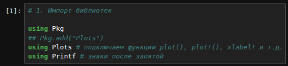{#fig-002 width=70%}

Далее задали начальные параметры модели. Производится ввод ёмкости системы C, полнодоступной части пропускной способности соты g, интенсивности потоков запросов $\lambda_1$, $\lambda_2$ и интенсивности обслживания $\mu_1$, $\mu_2$. На основе введенных данных рассчитываются интенсивности предложенных нагрузок $\rho_1 = \frac {\lambda_1} {\mu_1}$, $\rho_2 = \frac {\lambda_2} {\mu_2}$. Для численного анализа были выбраны следующие параметры: $C = 4, g = 3, \lambda_1 = 1, \lambda_2 = 1, \mu_1 = 2, \mu_2 = 1$. Также были посчитаны $\rho_1 = 0.5$ и $\rho_2 = 1$ ([рис. @fig-003])

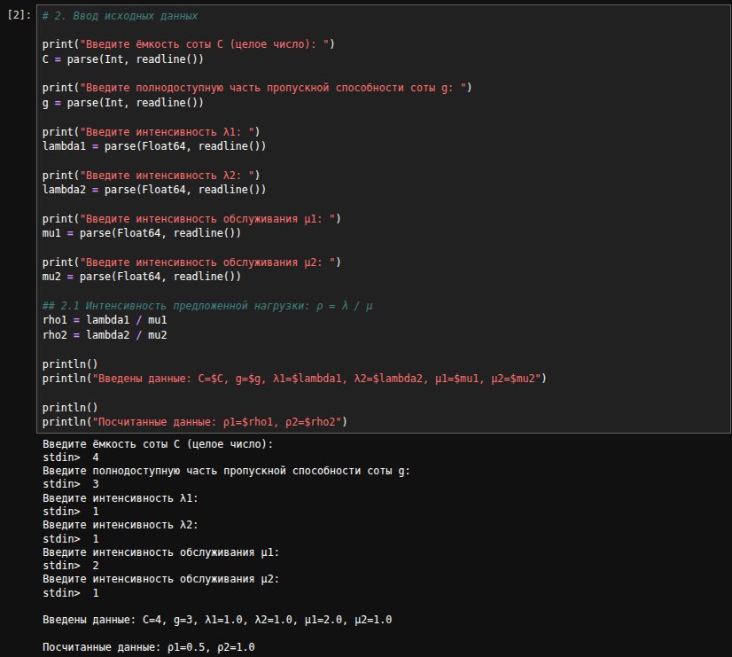{#fig-003 width=70%}

Для расчёта пространства состояний системы реализовали функцию ```state_space```, которая перебирает все пары $(n_1, n_2)$ с ограничениями$n_1 \le g$ и $n_1 + n_2 \le C$, а затем возвращает список этих допустимых состояний ([рис. @fig-004])

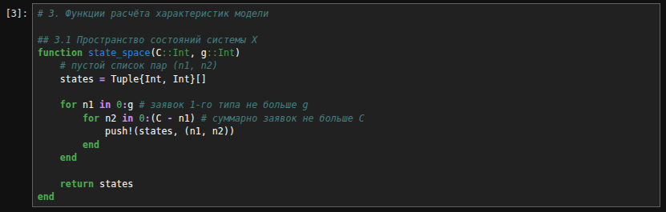{#fig-004 width=70%}

Для расчёта стационарного распределения вероятностей реализовали функцию ```stationary_probability```, которая сначала находит нормировочную константу $p(0,0)$ суммированием $\frac{\rho_1^i}{i!}\cdot\frac{\rho_2^j}{j!}$ по всем допустимым состояниям ($i \le g$, $i + j \le C$), а затем возвращает вероятность $p(n_1, n_2)$ заданного состояния, умножая такое же произведение для $(n_1, n_2)$ на $p(0,0)$ ([рис. @fig-005])

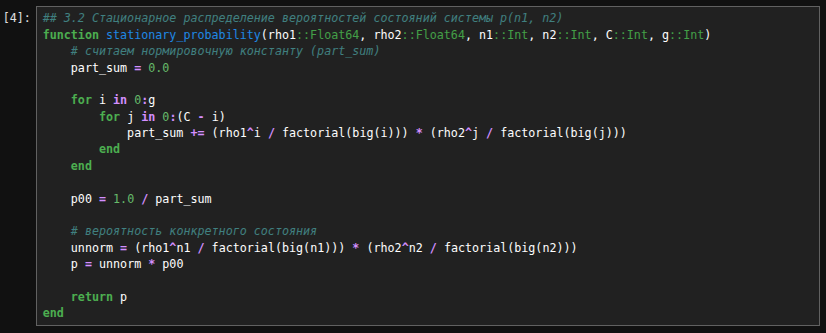{#fig-005 width=70%}

Для расчёта множества блокировок запросов услуги i-ого типа реализовали функцию ```blocking_set```, которая перебирает все состояния из $X$ и отбирает те, в которых запрос данного типа блокируется: для услуги 1 это состояния с $n_1 = g$ или $n_1 + n_2 = C$, для услуги 2 состояния с $n_1 + n_2 = C$, после чего возвращает список этих состояний ([рис. @fig-006])

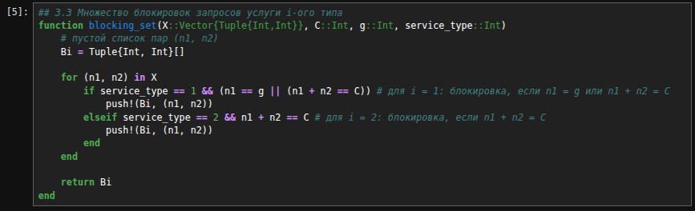{#fig-006 width=70%}

Для расчёта множества приёма заявок услуги i-ого типа реализовали функцию ```admission_set```, которая перебирает все состояния из $X$ и отбирает те, которые не принадлежат множеству блокировок $B_i$, после чего возвращает список этих состояний ([рис. @fig-007])

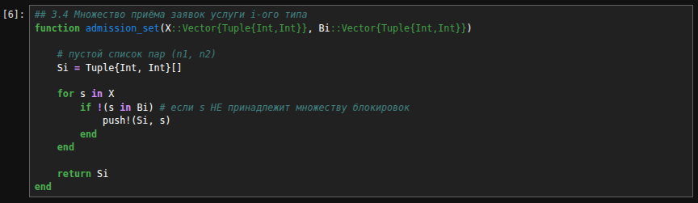{#fig-007 width=70%}

Для расчёта вероятности блокировки запроса на предоставление услуги $B_i, i = 1,2$ реализовали функцию ```blocking_probability```, которая суммирует вероятности $p(n_1, n_2)$ всех состояний из множества блокировок $B_i$, беря их из готового словаря распределения, и возвращает полученную сумму ([рис. @fig-008])

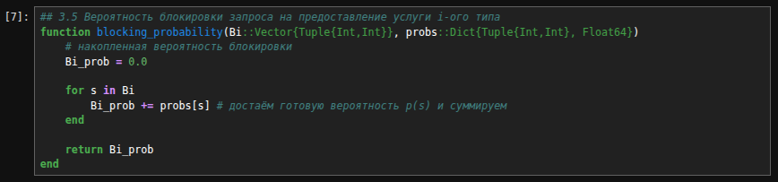{#fig-008 width=70%}

Для расчёта среднего числа $\overline{N}_i, i = 1,2$ обслуживаемых в системе запросов реализовали функцию ```average_requests```, которая по всем состояниям $(n_1, n_2)$ суммирует произведения $n_i \cdot p(n_1, n_2)$, то есть число запросов $i$-го типа, умноженное на вероятность состояния, и возвращает полученное математическое ожидание ([рис. @fig-009])

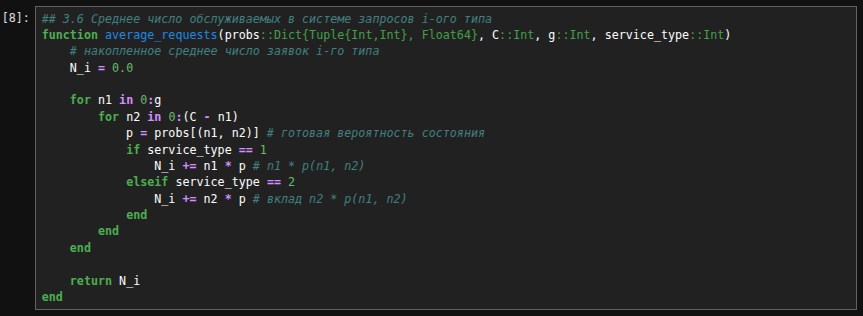{#fig-009 width=70%}

После запустили программу с заданными параметрами и получили пространство состояний системы $X$, состоящее из 14 состояний. На экран вывелись число состояний $|X| = 14$ и все пары $(n_1, n_2)$ от $(0, 0)$ до $(3, 1)$ ([рис. @fig-010])

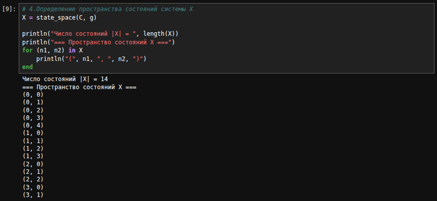{#fig-010 width=70%}

Далее определили множества блокировок запросов каждого типа. Множество $B_1$ содержит 5 состояний: $(0, 4)$, $(1, 3)$, $(2, 2)$, $(3, 1)$ и $(3, 0)$. Множество $B_2$ содержит 4 состояния: $(0, 4)$, $(1, 3)$, $(2, 2)$ и $(3, 1)$ ([рис. @fig-011])

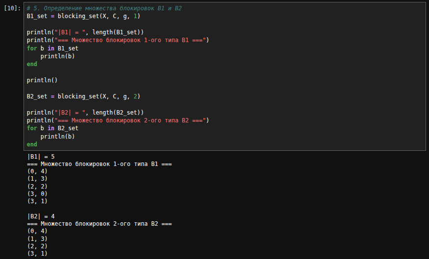{#fig-011 width=70%}

Далее определили множества приёма заявок каждого типа. Множество $S_1$ содержит 9 состояний: $(0, 0)$, $(0, 1)$, $(0, 2)$, $(0, 3)$, $(1, 0)$, $(1, 1)$, $(1, 2)$, $(2, 0)$ и $(2, 1)$. Множество $S_2$ содержит 10 состояний: $(0, 0)$, $(0, 1)$, $(0, 2)$, $(0, 3)$, $(1, 0)$, $(1, 1)$, $(1, 2)$, $(2, 0)$, $(2, 1)$ и $(3, 0)$ ([рис. @fig-012])

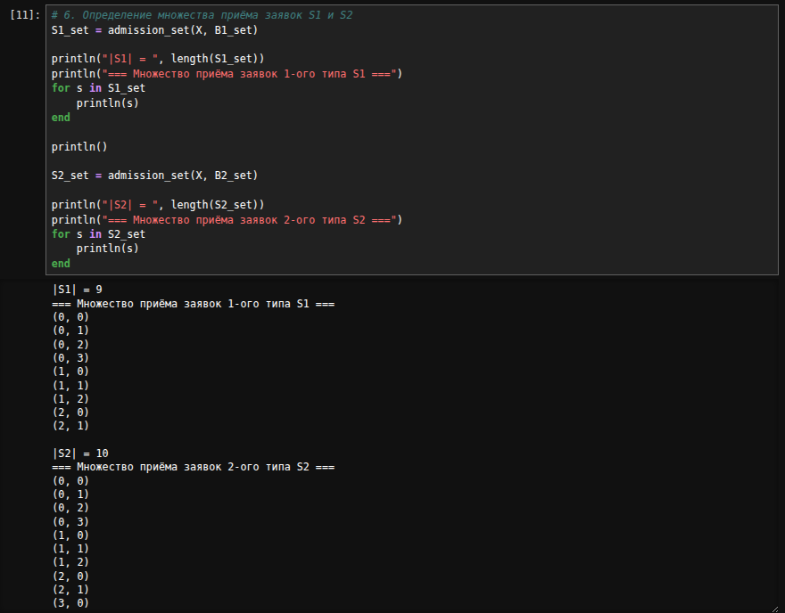{#fig-012 width=70%}

Далее получили стационарное распределение вероятностей состояний системы. На экран вывелись значения $p(n_1, n_2)$ для всех $n_1$ от 0 до 3 и $n_2$ от 0 до $C - n_1$ (то есть для всех 14 состояний), а также сумма вероятностей, которая равна 1 ([рис. @fig-013])

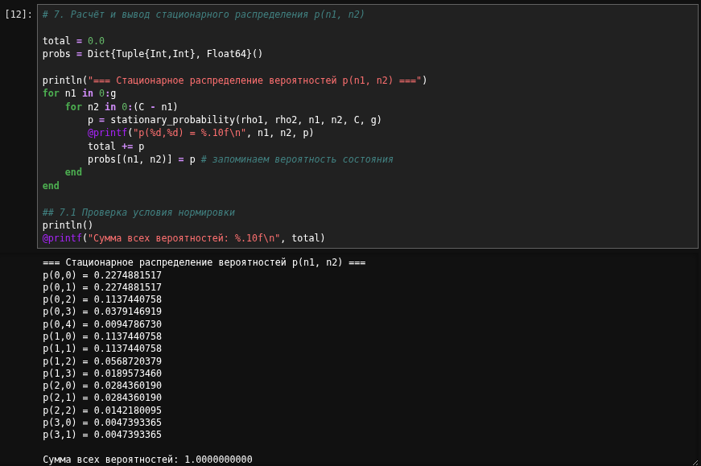{#fig-013 width=70%}

Далее вывели значения вероятностных характеристик модели. 

Вероятность блокировки запроса $B_1$ = 0.0521327014 и $B_2$ = 0.0.0473933649 ([рис. @fig-014])

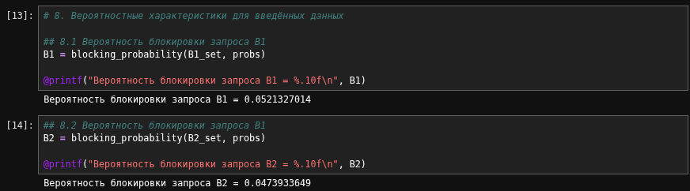{#fig-014 width=70%}

Среднее число обслуживаемых запросов $N_1$ = 0.4739336493, $N_2$ = 0.9526066351 и $N$ = 1.4265402844 ([рис. @fig-015])

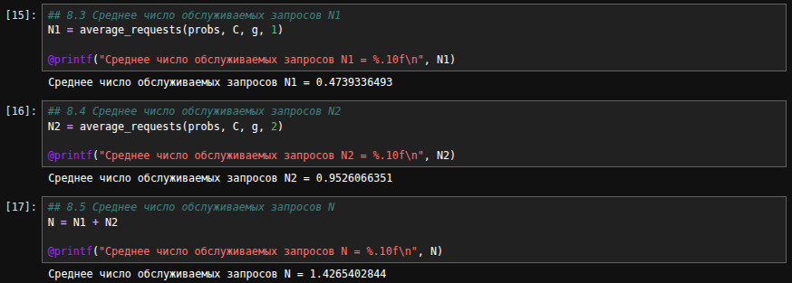{#fig-015 width=70%}

## Построение диаграммы интенсивностей переходов

Для построения диаграммы интенсивностей переходов реализовали функцию ```draw_state_diagram```. Она размещает каждое состояние $(n_1, n_2)$ в точке плоскости с координатами $(n_1, n_2)$ и для каждого состояния рисует пары стрелок к правому и верхнему соседям, если те принадлежат $X$: вправо и вверх с интенсивностями $\lambda_1$, $\lambda_2$ (приход запроса), обратно с интенсивностями $(n_1+1)\mu_1$ и $(n_2+1)\mu_2$ (завершение обслуживания). Кружки состояний раскрашиваются по множествам блокировок $B_1$, $B_2$, а функция возвращает готовый график ([рис. @fig-016])

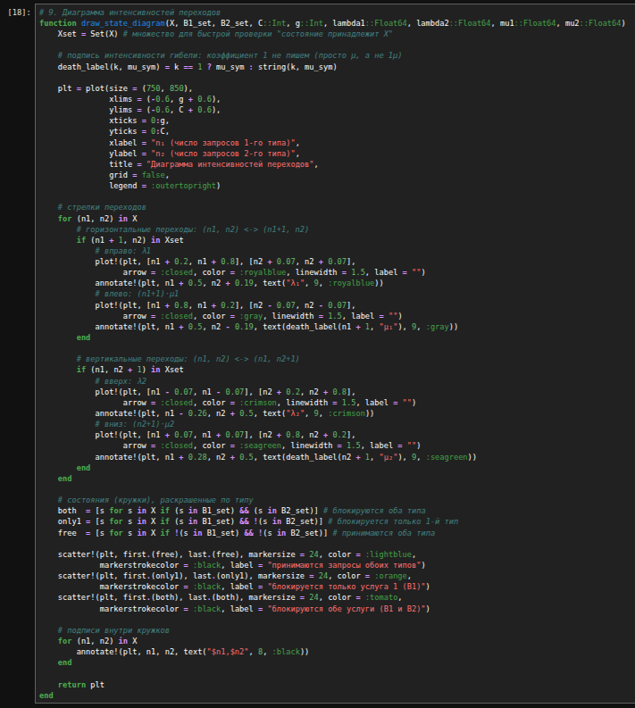{#fig-016 width=70%}

Далее построили диаграмму интенсивностей переходов ([рис. @fig-017])

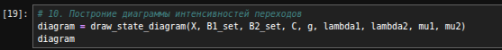{#fig-017 width=70%}

### Анализ диаграммы интенсивностей переходов 

На ([рис. @fig-018]) изображена диаграмма интенсивностей переходов. На ней видно, что 14 состояний системы образуют «лесенку», так как $n_1 \le g = 3$ и $n_1 + n_2 \le C = 4$. Стрелки вправо и вверх с интенсивностями $\lambda_1$ и $\lambda_2$ соответствуют приходу запроса 1-го и 2-го типа, а обратные стрелки влево и вниз с интенсивностями $n\mu_1$ и $n\mu_2$ (например, $\mu_1$, $2\mu_1$, $3\mu_1$ и $\mu_2$, $2\mu_2$, $3\mu_2$, $4\mu_2$) соответствуют завершению обслуживания, причём интенсивность растёт с числом обслуживаемых запросов. В состояниях блокировки нет стрелок прихода: из состояний $(0,4)$, $(1,3)$, $(2,2)$, $(3,1)$ (красные) нет ни $\lambda_1$, ни $\lambda_2$, так как заняты все каналы, а из состояния $(3,0)$ (оранжевое) нет стрелки $\lambda_1$, потому что исчерпан лимит $n_1 = g$, но стрелка $\lambda_2$ есть, и запрос 2-го типа ещё принимается. Остальные 9 состояний (голубые) принимают запросы обоих типов

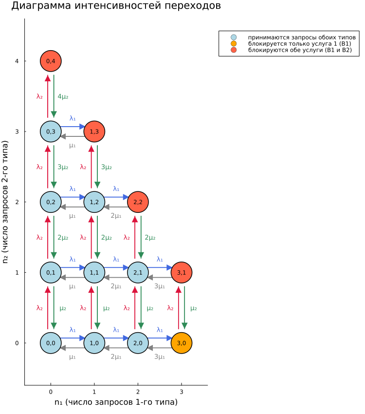{#fig-018 width=70%}

## Построение графиков

Для построения графиков зависимостей вероятностных характеристик от интенсивности поступления запросов расчёт был организован для двух случаев: при фиксированной $\lambda_2$ и меняющейся $\lambda_1$, а также при фиксированной $\lambda_1$ и меняющейся $\lambda_2$. В каждом случае выполнялся цикл по диапазону значений интенсивности от 0 до 16 с шагом 0.2: для каждого значения заново пересчитывались нагрузка и распределение вероятностей $p(n_1, n_2)$, по которому находились вероятности блокировки $B_1$, $B_2$ и средние числа запросов $\overline{N}_1$, $\overline{N}_2$, а также суммарное число $\overline{N} = \overline{N}_1 + \overline{N}_2$, после чего результаты сохранялись в отдельные массивы. Это позволило получить наборы точек для построения графиков зависимости вероятностей блокировки и среднего числа обслуживаемых запросов от интенсивности $\lambda_1$ и $\lambda_2$ ([рис. @fig-019])

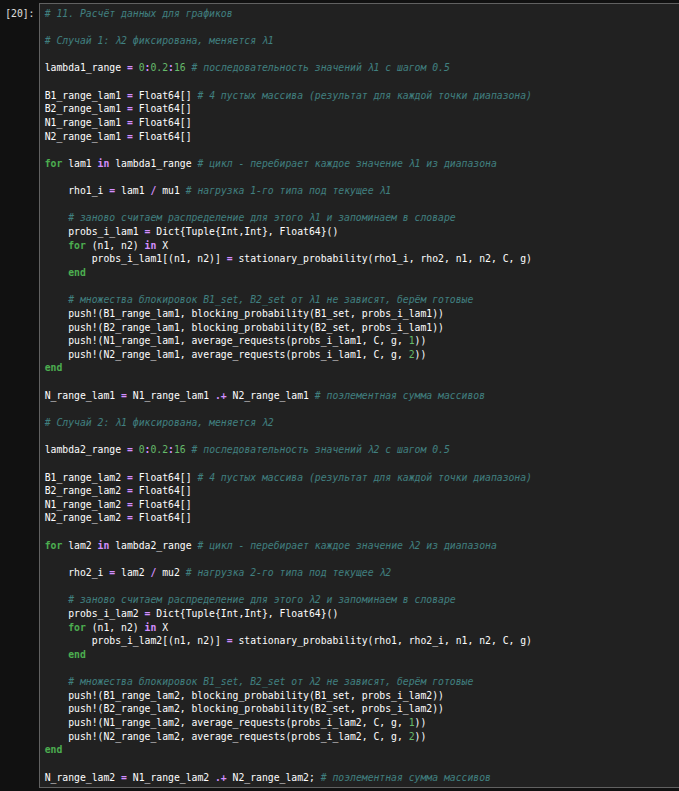{#fig-019 width=70%}

Далее на основе полученных данных построили 4 графика:

- Вероятность блокировки $B_1$($\lambda_1$) и $B_2$($\lambda_1$) при фиксированном $\lambda_2$ ([рис. @fig-020])
- Вероятность блокировки $B_1$($\lambda_2$) и $B_2$($\lambda_2$) при фиксированном $\lambda_1$ ([рис. @fig-021])
- Среднее число запросов $N_1$($\lambda_1$), $N_2$($\lambda_1$) и $N$($\lambda_1$ при фиксированном $\lambda_2$ ([рис. @fig-022])
- Среднее число запросов $N_1$($\lambda_2$), $N_2$($\lambda_2$) и $N$($\lambda_2$) при фиксированном $\lambda_1$ ([рис. @fig-023])

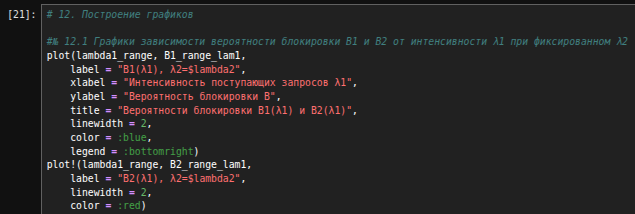{#fig-020 width=70%}

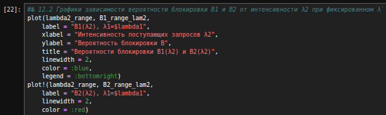{#fig-021 width=70%}

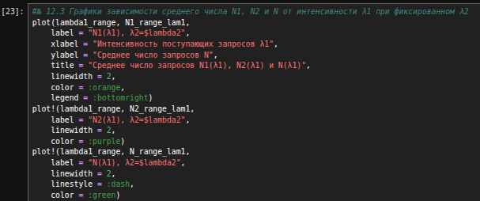{#fig-022 width=70%}

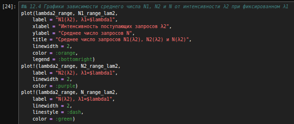{#fig-023 width=70%}

### Анализ графиков

**График $B_1$($\lambda_1$) и $B_2$($\lambda_1$):** на этом графике ([рис. @fig-024]) видно, что обе вероятности блокировки монотонно возрастают с ростом $\lambda_1$ (при $\lambda_2 = 1$), причём $B_1$ растёт быстрее и при $\lambda_1 = 16$ достигает около 0.69, а $B_2$ замедляет рост и выходит к значению около 0.37. При $\lambda_1 = 0$ кривые совпадают (около 0.015): запросов 1-го типа нет, и оба множества блокировок сводятся к состоянию $(0, C)$, в котором заняты все каналы. Рост обеих вероятностей объясняется тем, что с увеличением нагрузки первого типа система чаще оказывается заполненной. Кривая $B_1$ идёт выше, потому что запросы 1-го типа блокируются не только при полной загрузке ($n_1 + n_2 = C$), но и при достижении лимита $n_1 = g$, тогда как запросы 2-го типа блокируются только при полной загрузке

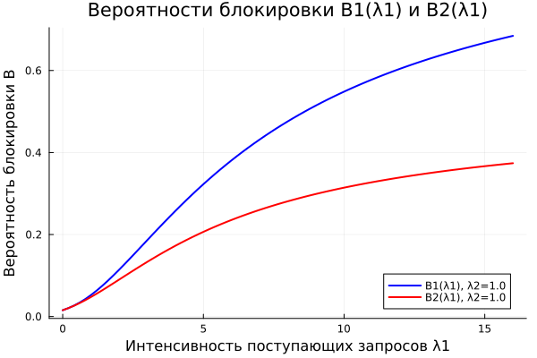{#fig-024 width=70%}

**График $B_1$($\lambda_2$) и $B_2$($\lambda_2$):** на этом графике ([рис. @fig-025]) видно, что обе вероятности блокировки монотонно возрастают с ростом $\lambda_2$ (при $\lambda_1 = 1$) и к $\lambda_2 = 16$ достигают около 0.77. Кривые практически совпадают: заметная разница есть только при малых $\lambda_2$, где $B_1$ чуть выше (при $\lambda_2 = 0$ вероятность $B_2$ равна нулю, а $B_1$ около 0.013). Рост объясняется тем, что с увеличением нагрузки второго типа система всё чаще оказывается заполненной целиком ($n_1 + n_2 = C$), и блокируются запросы обоих типов. Кривые сближаются потому, что при большой нагрузке второго типа состояния с $n_1 = g$ и свободными каналами, которые блокируют только запросы 1-го типа (отличие $B_1$ от $B_2$), встречаются всё реже: запросы 1-го типа приходят с небольшой фиксированной интенсивностью, и $n_1$ редко достигает лимита $g$

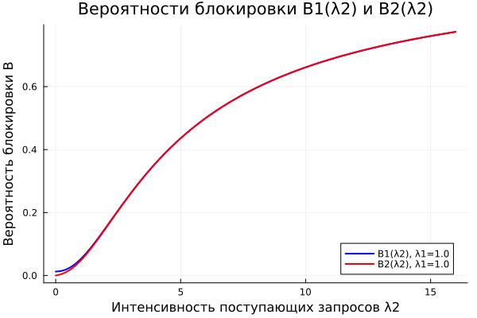{#fig-025 width=70%}

**График $N_1$($\lambda_1$), $N_2$($\lambda_1$) и $N$($\lambda_1$):** на этом графике ([рис. @fig-026]) видно, что среднее число запросов 1-го типа $N_1$ монотонно возрастает с ростом $\lambda_1$ (от 0 до примерно 2.5 при $\lambda_1 = 16$), при этом рост постепенно замедляется. Среднее число запросов 2-го типа $N_2$ медленно убывает (от примерно 1 до 0.6), а суммарное число $N = N_1 + N_2$ возрастает и выходит на насыщение около 3.2. Кривые $N_1$ и $N_2$ пересекаются при $\lambda_1 \approx 2$. Рост $N_1$ объясняется увеличением нагрузки первого типа, а замедление роста и насыщение связаны с ограничениями модели: $n_1 \le g = 3$ и $n_1 + n_2 \le C = 4$, из-за чего при большой нагрузке вероятность блокировки растёт, и дополнительные запросы уже не обслуживаются. Убывание $N_2$ объясняется тем, что запросы 1-го типа всё чаще занимают каналы и вытесняют запросы 2-го типа. Суммарное число $N$ не превышает $C = 4$ и стремится к значению ниже него, так как запросы 1-го типа не могут занять больше $g = 3$ каналов

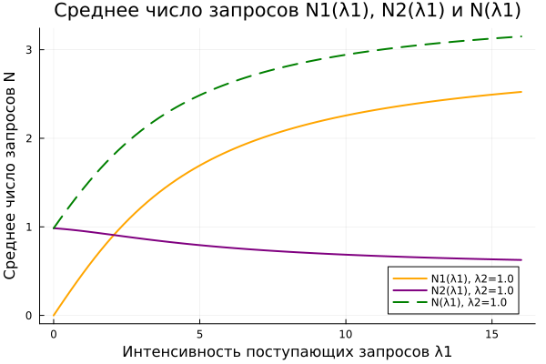{#fig-026 width=70%}

**График $N_1$($\lambda_2$), $N_2$($\lambda_2$) и $N$($\lambda_2$):** на этом графике ([рис. @fig-027]) видно, что среднее число запросов 2-го типа $N_2$ монотонно возрастает с ростом $\lambda_2$ (от 0 до примерно 3.6 при $\lambda_2 = 16$), причём рост постепенно замедляется. Среднее число запросов 1-го типа $N_1$, наоборот, убывает (от примерно 0.5 до 0.1), а суммарное число $N = N_1 + N_2$ возрастает от 0.5 и выходит на насыщение около 3.7, приближаясь к ёмкости $C = 4$, но не достигая её. Кривые $N_1$ и $N_2$ пересекаются при $\lambda_2 \approx 0.5$. Рост $N_2$ объясняется увеличением нагрузки второго типа, а замедление роста связано с ограничением $n_1 + n_2 \le C$: при большой нагрузке система почти всегда заполнена, вероятность блокировки растёт, и дополнительные запросы уже не обслуживаются. Убывание $N_1$ объясняется тем, что запросы 2-го типа всё чаще занимают каналы и вытесняют запросы 1-го типа, интенсивность которых остаётся неизменной ($\lambda_1 = 1$). В отличие от графика по $\lambda_1$, здесь $N$ стремится именно к $C$: запросы 2-го типа не ограничены лимитом $g$ и в пределе могут занять все каналы

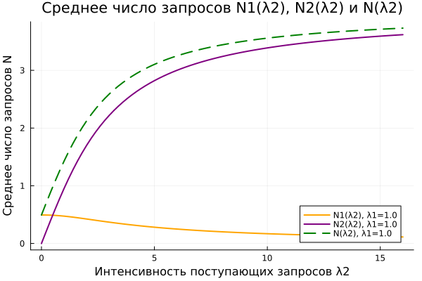{#fig-027 width=70%}

# Листинг программы

```julia
# 1. Импорт библиотек

using Pkg
Pkg.add("Plots") # устанавливает пакет для построения графиков
using Plots # подключаем функции plot(), plot!(), xlabel! и т.д.
using Printf # знаки после запятой

# 2. Ввод исходных данных

print("Введите ёмкость соты C (целое число): ")
C = parse(Int, readline())

print("Введите полнодоступную часть пропускной способности соты g: ")
g = parse(Int, readline())

print("Введите интенсивность λ1: ")
lambda1 = parse(Float64, readline())

print("Введите интенсивность λ2: ")
lambda2 = parse(Float64, readline())

print("Введите интенсивность обслуживания μ1: ")
mu1 = parse(Float64, readline())

print("Введите интенсивность обслуживания μ2: ")
mu2 = parse(Float64, readline())

## 2.1 Интенсивность предложенной нагрузки: ρ = λ / μ
rho1 = lambda1 / mu1
rho2 = lambda2 / mu2

println()
println("Введены данные: C=$C, g=$g, λ1=$lambda1, λ2=$lambda2, μ1=$mu1, μ2=$mu2")

println()
println("Посчитанные данные: ρ1=$rho1, ρ2=$rho2")
println()

# 3. Функции расчёта характеристик модели

## 3.1 Пространство состояний системы X
function state_space(C::Int, g::Int)
    # пустой список пар (n1, n2)
    states = Tuple{Int, Int}[]            
    
    for n1 in 0:g # заявок 1-го типа не больше g
        for n2 in 0:(C - n1) # суммарно заявок не больше C
            push!(states, (n1, n2))
        end
    end

    return states
end

## 3.2 Стационарное распределение вероятностей состояний системы p(n1, n2)
function stationary_probability(rho1::Float64, rho2::Float64, n1::Int, n2::Int, C::Int, g::Int)
    # считаем нормировочную константу (part_sum)
    part_sum = 0.0
    
    for i in 0:g
        for j in 0:(C - i)
            part_sum += (rho1^i / factorial(big(i))) * (rho2^j / factorial(big(j)))
        end
    end

    p00 = 1.0 / part_sum

    # вероятность конкретного состояния
    unnorm = (rho1^n1 / factorial(big(n1))) * (rho2^n2 / factorial(big(n2)))
    p = unnorm * p00

    return p
end

## 3.3 Множество блокировок запросов услуги i-ого типа
function blocking_set(X::Vector{Tuple{Int,Int}}, C::Int, g::Int, service_type::Int)
    # пустой список пар (n1, n2)
    Bi = Tuple{Int, Int}[]
    
    for (n1, n2) in X
        if service_type == 1 && (n1 == g || (n1 + n2 == C)) # для i = 1: блокировка, если n1 = g или n1 + n2 = C 
            push!(Bi, (n1, n2))
        elseif service_type == 2 && n1 + n2 == C # для i = 2: блокировка, если n1 + n2 = C
            push!(Bi, (n1, n2))
        end
    end
    
    return Bi
end

## 3.4 Множество приёма заявок услуги i-ого типа
function admission_set(X::Vector{Tuple{Int,Int}}, Bi::Vector{Tuple{Int,Int}})
    
    # пустой список пар (n1, n2)
    Si = Tuple{Int, Int}[]
    
    for s in X
        if !(s in Bi) # если s НЕ принадлежит множеству блокировок 
            push!(Si, s)
        end
    end
    
    return Si
end

## 3.5 Вероятность блокировки запроса на предоставление услуги i-ого типа 
function blocking_probability(Bi::Vector{Tuple{Int,Int}}, probs::Dict{Tuple{Int,Int}, Float64})
    # накопленная вероятность блокировки
    Bi_prob = 0.0
    
    for s in Bi
        Bi_prob += probs[s] # достаём готовую вероятность p(s) и суммируем
    end
    
    return Bi_prob
end

## 3.6 Среднее число обслуживаемых в системе запросов i-ого типа
function average_requests(probs::Dict{Tuple{Int,Int}, Float64}, C::Int, g::Int, service_type::Int)
    # накопленное среднее число заявок i-го типа
    N_i = 0.0  
    
    for n1 in 0:g
        for n2 in 0:(C - n1)
            p = probs[(n1, n2)] # готовая вероятность состояния
            if service_type == 1
                N_i += n1 * p # n1 * p(n1, n2)
            elseif service_type == 2
                N_i += n2 * p # вклад n2 * p(n1, n2)
            end
        end
    end
    
    return N_i                                
end

# 4.Определение пространства состояний системы X
X = state_space(C, g)

println("Число состояний |X| = ", length(X))
println("=== Пространство состояний X ===")
for (n1, n2) in X
    println("(", n1, ", ", n2, ")")
end

println()

# 5. Определение множества блокировок B1 и B2
B1_set = blocking_set(X, C, g, 1)

println("|B1| = ", length(B1_set))
println("=== Множество блокировок 1-ого типа B1 ===")
for b in B1_set
    println(b)
end

println()

B2_set = blocking_set(X, C, g, 2)

println("|B2| = ", length(B2_set))
println("=== Множество блокировок 2-ого типа B2 ===")
for b in B2_set
    println(b)
end

println()

# 6. Определение множества приёма заявок S1 и S2
S1_set = admission_set(X, B1_set)

println("|S1| = ", length(S1_set))
println("=== Множество приёма заявок 1-ого типа S1 ===")
for s in S1_set
    println(s)
end

println()

S2_set = admission_set(X, B2_set)

println("|S2| = ", length(S2_set))
println("=== Множество приёма заявок 2-ого типа S2 ===")
for s in S2_set
    println(s)
end

println()

# 7. Расчёт и вывод стационарного распределения p(n1, n2)

total = 0.0
probs = Dict{Tuple{Int,Int}, Float64}()

println("=== Стационарное распределение вероятностей p(n1, n2) ===")
for n1 in 0:g
    for n2 in 0:(C - n1)
        p = stationary_probability(rho1, rho2, n1, n2, C, g)
        @printf("p(%d,%d) = %.10f\n", n1, n2, p)
        global total += p
        probs[(n1, n2)] = p # запоминаем вероятность состояния
    end
end

## 7.1 Проверка условия нормировки
println()
@printf("Сумма всех вероятностей: %.10f\n", total)

println()

# 8. Вероятностные характеристики для введённых данных

## 8.1 Вероятность блокировки запроса B1
B1 = blocking_probability(B1_set, probs)
@printf("Вероятность блокировки запроса B1 = %.10f\n", B1)

## 8.2 Вероятность блокировки запроса B1
B2 = blocking_probability(B2_set, probs)
@printf("Вероятность блокировки запроса B2 = %.10f\n", B2)

## 8.3 Среднее число обслуживаемых запросов N1
N1 = average_requests(probs, C, g, 1)
@printf("Среднее число обслуживаемых запросов N1 = %.10f\n", N1)

## 8.4 Среднее число обслуживаемых запросов N2
N2 = average_requests(probs, C, g, 2)
@printf("Среднее число обслуживаемых запросов N2 = %.10f\n", N2)

## 8.5 Среднее число обслуживаемых запросов N
N = N1 + N2
@printf("Среднее число обслуживаемых запросов N = %.10f\n", N)

# 9. Диаграмма интенсивностей переходов
function draw_state_diagram(X, B1_set, B2_set, C::Int, g::Int, lambda1::Float64, lambda2::Float64, mu1::Float64, mu2::Float64)
    Xset = Set(X) # множество для быстрой проверки "состояние принадлежит X"

    # подпись интенсивности гибели: коэффициент 1 не пишем (просто μ, а не 1μ)
    death_label(k, mu_sym) = k == 1 ? mu_sym : string(k, mu_sym)

    plt = plot(size = (750, 850),
               xlims = (-0.6, g + 0.6),
               ylims = (-0.6, C + 0.6),
               xticks = 0:g,
               yticks = 0:C,
               xlabel = "n₁ (число запросов 1-го типа)",
               ylabel = "n₂ (число запросов 2-го типа)",
               title = "Диаграмма интенсивностей переходов",
               grid = false,
               legend = :outertopright)

    # стрелки переходов
    for (n1, n2) in X
        # горизонтальные переходы: (n1, n2) <-> (n1+1, n2)
        if (n1 + 1, n2) in Xset
            # вправо: λ1
            plot!(plt, [n1 + 0.2, n1 + 0.8], [n2 + 0.07, n2 + 0.07],
                  arrow = :closed, color = :royalblue, linewidth = 1.5, label = "")
            annotate!(plt, n1 + 0.5, n2 + 0.19, text("λ₁", 9, :royalblue))
            # влево: (n1+1)·μ1
            plot!(plt, [n1 + 0.8, n1 + 0.2], [n2 - 0.07, n2 - 0.07],
                  arrow = :closed, color = :gray, linewidth = 1.5, label = "")
            annotate!(plt, n1 + 0.5, n2 - 0.19, text(death_label(n1 + 1, "μ₁"), 9, :gray))
        end

        # вертикальные переходы: (n1, n2) <-> (n1, n2+1)
        if (n1, n2 + 1) in Xset
            # вверх: λ2
            plot!(plt, [n1 - 0.07, n1 - 0.07], [n2 + 0.2, n2 + 0.8],
                  arrow = :closed, color = :crimson, linewidth = 1.5, label = "")
            annotate!(plt, n1 - 0.26, n2 + 0.5, text("λ₂", 9, :crimson))
            # вниз: (n2+1)·μ2
            plot!(plt, [n1 + 0.07, n1 + 0.07], [n2 + 0.8, n2 + 0.2],
                  arrow = :closed, color = :seagreen, linewidth = 1.5, label = "")
            annotate!(plt, n1 + 0.28, n2 + 0.5, text(death_label(n2 + 1, "μ₂"), 9, :seagreen))
        end
    end

    # состояния (кружки), раскрашенные по типу
    both  = [s for s in X if (s in B1_set) && (s in B2_set)] # блокируются оба типа
    only1 = [s for s in X if (s in B1_set) && !(s in B2_set)] # блокируется только 1-й тип
    free  = [s for s in X if !(s in B1_set) && !(s in B2_set)] # принимаются оба типа

    scatter!(plt, first.(free), last.(free), markersize = 24, color = :lightblue,
             markerstrokecolor = :black, label = "принимаются запросы обоих типов")
    scatter!(plt, first.(only1), last.(only1), markersize = 24, color = :orange,
             markerstrokecolor = :black, label = "блокируется только услуга 1 (B1)")
    scatter!(plt, first.(both), last.(both), markersize = 24, color = :tomato,
             markerstrokecolor = :black, label = "блокируются обе услуги (B1 и B2)")

    # подписи внутри кружков
    for (n1, n2) in X
        annotate!(plt, n1, n2, text("$n1,$n2", 8, :black))
    end

    return plt
end

# 10. Построние диаграммы интенсивностей переходов
diagram = draw_state_diagram(X, B1_set, B2_set, C, g, lambda1, lambda2, mu1, mu2)
savefig(diagram, "state_diagram.png")
display(diagram)

# 11. Расчёт данных для графиков

# Случай 1: λ2 фиксирована, меняется λ1

lambda1_range = 0:0.2:16 # последовательность значений λ1 с шагом 0.5

B1_range_lam1 = Float64[] # 4 пустых массива (результат для каждой точки диапазона)
B2_range_lam1 = Float64[]
N1_range_lam1 = Float64[]
N2_range_lam1 = Float64[]

for lam1 in lambda1_range # цикл - перебирает каждое значение λ1 из диапазона 

    rho1_i = lam1 / mu1 # нагрузка 1-го типа под текущее λ1

    # заново считаем распределение для этого λ1 и запоминаем в словаре
    probs_i_lam1 = Dict{Tuple{Int,Int}, Float64}()
    for (n1, n2) in X
        probs_i_lam1[(n1, n2)] = stationary_probability(rho1_i, rho2, n1, n2, C, g)
    end
    
    # множества блокировок B1_set, B2_set от λ1 не зависят, берём готовые
    push!(B1_range_lam1, blocking_probability(B1_set, probs_i_lam1))
    push!(B2_range_lam1, blocking_probability(B2_set, probs_i_lam1))
    push!(N1_range_lam1, average_requests(probs_i_lam1, C, g, 1))
    push!(N2_range_lam1, average_requests(probs_i_lam1, C, g, 2))
end

N_range_lam1 = N1_range_lam1 .+ N2_range_lam1 # поэлементная сумма массивов

# Случай 2: λ1 фиксирована, меняется λ2

lambda2_range = 0:0.2:16 # последовательность значений λ2 с шагом 0.5

B1_range_lam2 = Float64[] # 4 пустых массива (результат для каждой точки диапазона)
B2_range_lam2 = Float64[]
N1_range_lam2 = Float64[]
N2_range_lam2 = Float64[]

for lam2 in lambda2_range # цикл - перебирает каждое значение λ2 из диапазона 

    rho2_i = lam2 / mu2 # нагрузка 2-го типа под текущее λ2

    # заново считаем распределение для этого λ2 и запоминаем в словаре
    probs_i_lam2 = Dict{Tuple{Int,Int}, Float64}()
    for (n1, n2) in X
        probs_i_lam2[(n1, n2)] = stationary_probability(rho1, rho2_i, n1, n2, C, g)
    end
    
    # множества блокировок B1_set, B2_set от λ2 не зависят, берём готовые
    push!(B1_range_lam2, blocking_probability(B1_set, probs_i_lam2))
    push!(B2_range_lam2, blocking_probability(B2_set, probs_i_lam2))
    push!(N1_range_lam2, average_requests(probs_i_lam2, C, g, 1))
    push!(N2_range_lam2, average_requests(probs_i_lam2, C, g, 2))
end

N_range_lam2 = N1_range_lam2 .+ N2_range_lam2; # поэлементная сумма массивов

# 12. Построение графиков

#№ 12.1 Графики зависимости вероятности блокировки B1 и B2 от интенсивности λ1 при фиксированном λ2
plot_B1_B2_lam1 = plot(lambda1_range, B1_range_lam1,
    label = "B1(λ1), λ2=$lambda2",
    xlabel = "Интенсивность поступающих запросов λ1",
    ylabel = "Вероятность блокировки B",
    title = "Вероятности блокировки B1(λ1) и B2(λ1)",
    linewidth = 2,
    color = :blue,
    legend = :bottomright)
plot!(lambda1_range, B2_range_lam1,
    label = "B2(λ1), λ2=$lambda2",
    linewidth = 2,
    color = :red)
savefig(plot_B1_B2_lam1, "blocking_probability_B1_B2_lam1.png")
display(plot_B1_B2_lam1) 

#№ 12.2 Графики зависимости вероятности блокировки B1 и B2 от интенсивности λ2 при фиксированном λ`
plot_B1_B2_lam2 = plot(lambda2_range, B1_range_lam2,
    label = "B1(λ2), λ1=$lambda1",
    xlabel = "Интенсивность поступающих запросов λ2",
    ylabel = "Вероятность блокировки B",
    title = "Вероятности блокировки B1(λ2) и B2(λ2)",
    linewidth = 2,
    color = :blue,
    legend = :bottomright)
plot!(lambda2_range, B2_range_lam2,
    label = "B2(λ2), λ1=$lambda1",
    linewidth = 2,
    color = :red)
savefig(plot_B1_B2_lam2, "blocking_probability_B1_B2_lam2.png")
display(plot_B1_B2_lam2)

#№ 12.3 Графики зависимости среднего числа N1, N2 и N от интенсивности λ1 при фиксированном λ2
plot_N1_N2_N_lam1 = plot(lambda1_range, N1_range_lam1,
    label = "N1(λ1), λ2=$lambda2",
    xlabel = "Интенсивность поступающих запросов λ1",
    ylabel = "Среднее число запросов N",
    title = "Среднее число запросов N1(λ1), N2(λ1) и N(λ1)",
    linewidth = 2,
    color = :orange,
    legend = :bottomright)
plot!(lambda1_range, N2_range_lam1,
    label = "N2(λ1), λ2=$lambda2",
    linewidth = 2,
    color = :purple)
plot!(lambda1_range, N_range_lam1,
    label = "N(λ1), λ2=$lambda2",
    linewidth = 2,
    linestyle = :dash,
    color = :green)
savefig(plot_N1_N2_N_lam1, "average_request_N1_N2_N_lam1.png")
display(plot_N1_N2_N_lam1)

#№ 12.4 Графики зависимости среднего числа N1, N2 и N от интенсивности λ2 при фиксированном λ1
plot_N1_N2_N_lam2 = plot(lambda2_range, N1_range_lam2,
    label = "N1(λ2), λ1=$lambda1",
    xlabel = "Интенсивность поступающих запросов λ2",
    ylabel = "Среднее число запросов N",
    title = "Среднее число запросов N1(λ2), N2(λ2) и N(λ2)",
    linewidth = 2,
    color = :orange,
    legend = :bottomright)
plot!(lambda2_range, N2_range_lam2,
    label = "N2(λ2), λ1=$lambda1",
    linewidth = 2,
    color = :purple)
plot!(lambda2_range, N_range_lam2,
    label = "N(λ2), λ1=$lambda1",
    linewidth = 2,
    linestyle = :dash,
    color = :green)
savefig(plot_N1_N2_N_lam2, "average_request_N1_N2_N_lam2.png")
display(plot_N1_N2_N_lam2)
```

# Выводы

В ходе выполнения лабораторной работы №4 была изучена неполнодоступная двухсервисная модель Эрланга с резервированием для заявок второго типа и разными интенсивностями обслуживания, а также были успешно реализованы нужные функции и построены графики. Все результаты успешно совпали с результатами из примера, который приведён в задании лабораторной работы. 

Анализ графиков показал, что:

- Вероятности блокировки $B_1$ и $B_2$ монотонно возрастают с ростом $\lambda_1$, причём $B_1 > B_2$, так как заявки первого типа блокируются ещё и при достижении лимита $n_1 = g$

- При росте $\lambda_2$ вероятности блокировки $B_1$ и $B_2$ также возрастают и почти совпадают

- С ростом интенсивности одного из потоков среднее число заявок этого типа растёт и выходит на насыщение, а среднее число заявок другого типа убывает, так как их вытесняют; суммарное число заявок $N$ растёт, но не превышает ёмкость $C$

Моделирование было успешно выполнено на языке Julia.
